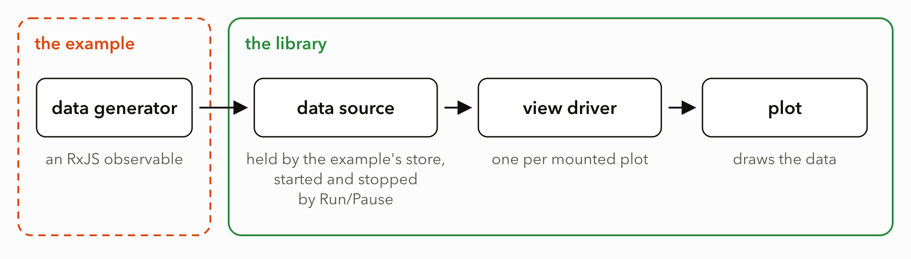
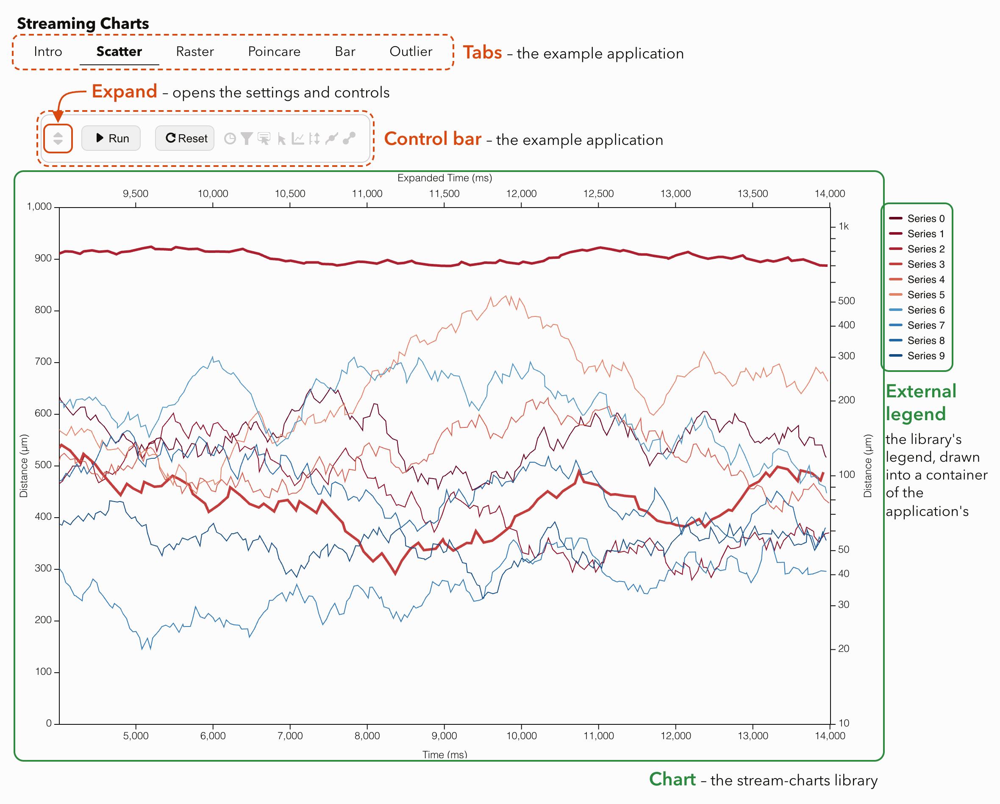
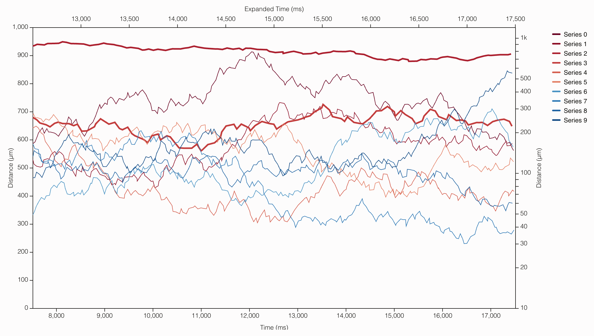
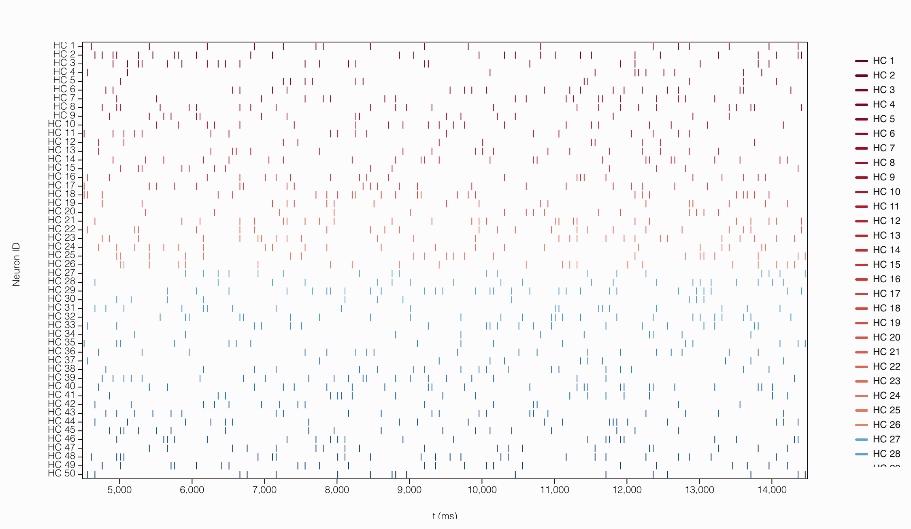
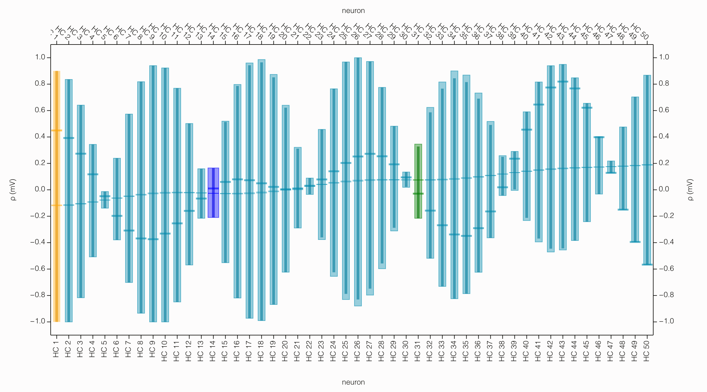
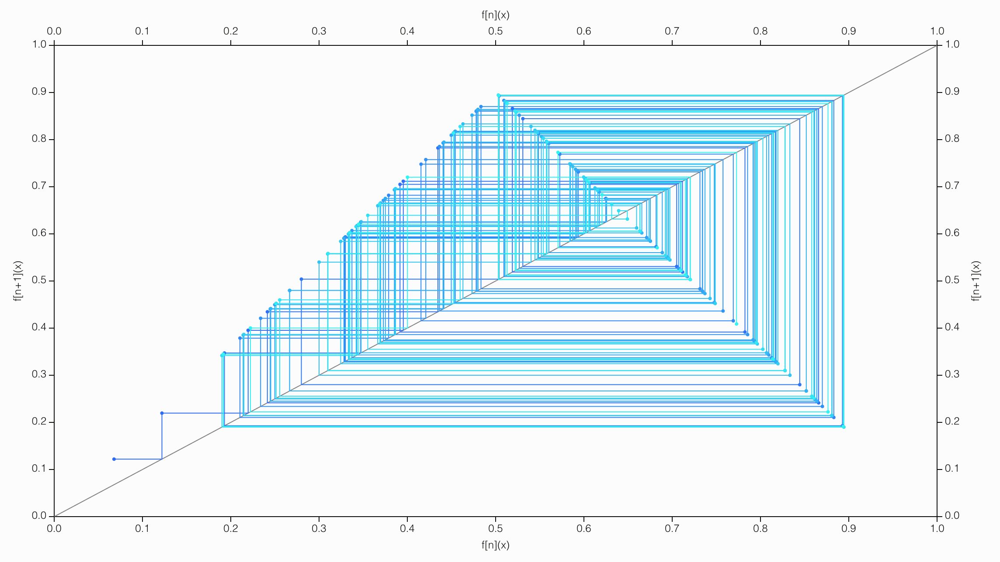
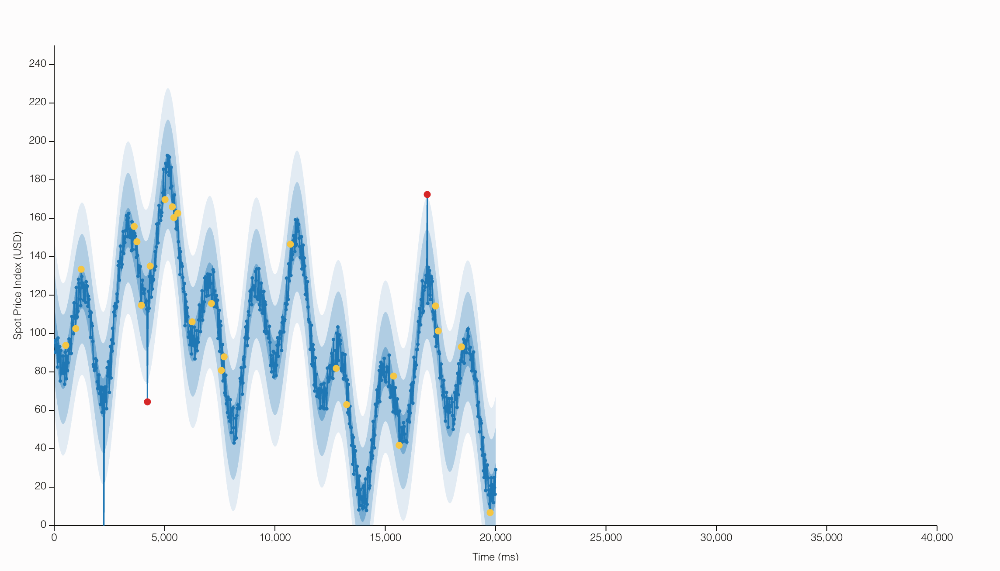
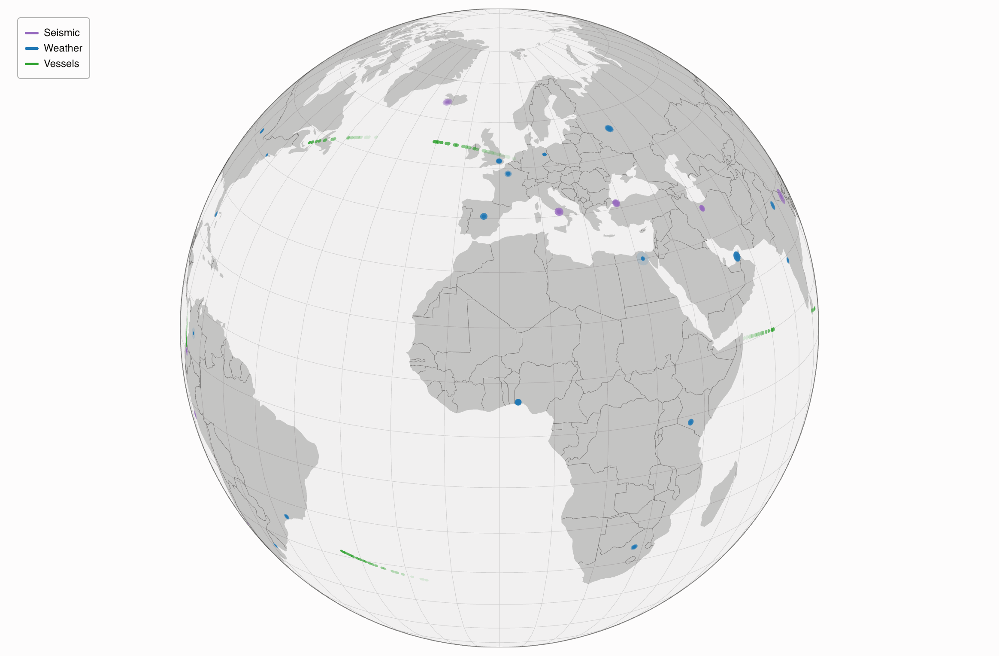
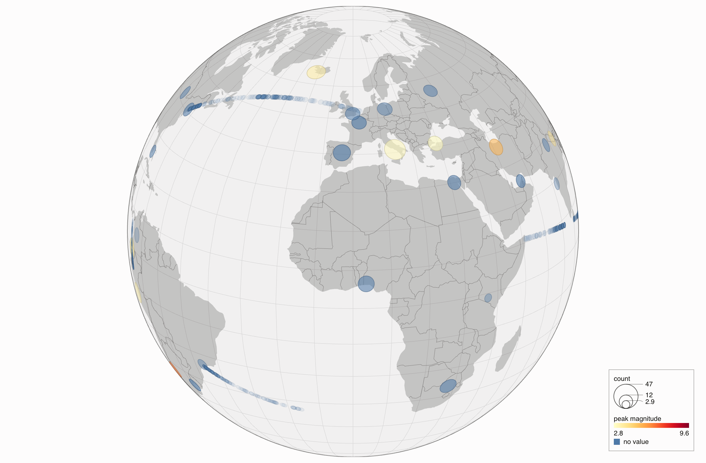

[](https://www.npmjs.com/package/stream-charts) [](https://github.com/robphilipp/stream-charts/actions/workflows/main.yml) [](LICENSE)

[Homepage](https://robphilipp.github.io/stream-charts/) •
[API Docs](https://robphilipp.github.io/stream-charts/docs/) •
[Change History](changes.md)

**`stream-charts`** is a [React](https://react.dev) library for real-time charts of high-frequency streaming data. This repository holds the library, and a **demo app** that shows each of its charts at work and lets you explore them.

<picture>
    <source media="(prefers-color-scheme: dark)" srcset="packages/examples/public/images/charts-collage-dark.gif">
    
</picture>

*Scatter, streaming (two x-axes, linear and log y-axes, hovering the legend highlights a series, cadence) · raster (legend, tooltip) · bar (running and windowed statistics, tooltip) · Poincaré (tooltip) · outlier (confidence bands, flagged outliers, tooltip) · geo (sensor events on a turning globe)*

**The library** charts data that never stops arriving. You hand it an [RxJS](https://rxjs.dev) observable of new data, and it buffers the updates, scrolls the time axes, and redraws – on a single canvas, so plotting new data for about 100 series every 25 ms isn't generally a problem. Along the way:

- **The data lives in a data source that your application owns**, not in the chart, so it keeps streaming while the chart is off screen, and the chart picks up where it left off when it comes back.
- **The charts stay usable while the data streams**: zoom and pan without losing "now", filter the series with a regular expression, and hover for tooltips (with statistics and sparklines), trackers, and legends that highlight the hovered series.
- **The charts are built from React components** – axes, a plot, and the extras you want – with up to two x-axes and two y-axes per chart, linear or logarithmic scales, and y-axes that can grow to fit the data.

**The demo app** (in [`packages/examples`](#run-demo)) has a tab for each chart type, each with a control bar for trying out the chart's options while the data streams – buffering, update rates, markers, interpolation, legends, and so on. Its intro walks through the charts and the library's design, with tutorials on adding your own data source, writing your own tooltips, building a scatter chart from sensor data, and building a geo chart of sensor events.

Six plot types are available:

| plot | for | example |
|---|---|---|
| [&lt;ScatterPlot/&gt;](#scatter-plot) | values over time (lines, with optional markers) | sensor readings, weights |
| [&lt;RasterPlot/&gt;](#raster-plot) | events over time, one row per category | neuron spikes |
| [&lt;BarPlot/&gt;](#bar-plot) | the current value and running statistics of each category | min, max, mean, and windowed min/max/mean |
| [&lt;PoincarePlot/&gt;](#poincare-plot) | a sequence plotted against itself (`f[n+m](x)` vs `f[n](x)`) | iterated maps, chaotic systems |
| [&lt;OutlierPlot/&gt;](#outlier-plot) | values over time, with confidence bands that flag outliers | a price index with 1σ, 2σ, 3σ bands |
| [&lt;GeoPlot/&gt;](#geo-plot) | events at places on the earth, one by one or rolled up by place, on a globe or a map | seismic stations, weather stations, and vessels at sea |

> Try the demo app online: [](https://codespaces.new/robphilipp/stream-charts?quickstart=1)
>
> This opens the repository in a GitHub codespace, installs it, and starts the demo app, which opens in a new browser tab (the first start takes a few minutes). You'll need a GitHub account, and the codespace counts against your account's free monthly Codespaces hours.

## <span id="content">content</span>

**[getting started](#getting-started)**
- [using the library in your application](#installation)
- [quick start](#quick-start)
- [how it works](#how-it-works)
- [migrating from 1.x](#migrating)
- [this repository: the library and the demo app](#repository)
- [running the demo app](#run-demo)
- [working on the library](#contributing)

**[data](#data)**
- [data sources](#data-sources)
- [generators](#generators)
- [chart data, one shape for each plot](#chart-data)
- [series and datum helpers](#series-helpers)
- [performance: data TTL, windowing, and cadence](#performance)

**[components](#components)**
- [&lt;Chart/&gt;](#chart)
- [axes: &lt;ContinuousAxis/&gt;, &lt;OrdinalAxis/&gt;, &lt;EmptyAxis/&gt;](#axes)
- [plots](#plots)
  - [properties common to the plots](#plot-common)
  - [&lt;ScatterPlot/&gt;](#scatter-plot)
  - [&lt;RasterPlot/&gt;](#raster-plot)
  - [&lt;BarPlot/&gt;](#bar-plot)
  - [&lt;PoincarePlot/&gt;](#poincare-plot)
  - [&lt;OutlierPlot/&gt;](#outlier-plot)
  - [&lt;GeoPlot/&gt;](#geo-plot)
- [&lt;Tracker/&gt;](#tracker)
- [&lt;Legend/&gt;](#legend)
- [&lt;Tooltip/&gt; and tooltip content](#tooltip)
  - [writing your own tooltip content](#custom-tooltip)

**[more](#more)**
- [theming](#theming)
- [filtering series](#filtering)
- [hooks](#hooks)
- [further reading](#further-reading)

---

## <span id="getting-started">getting started</span> [↑](#content "back to contents")

What to install depends on what you'd like to do:

| you'd like to... | install | then see |
|---|---|---|
| **use the charts in your own application** | the library, from npm | [using the library in your application](#installation), then the [quick start](#quick-start) |
| **explore the charts**, see how each one is put together, and try out ideas – a chart of your own, say – in a working app | the demo app: clone this repository | [running the demo app](#run-demo) |
| **add charts or features to the library**, and contribute them back with a pull request | the library's source, which comes with the demo app: fork this repository | [working on the library](#contributing) |

### <span id="installation">using the library in your application</span> [↑](#content "back to contents")

```shell
npm install stream-charts react react-dom rxjs d3
```

> This README describes version 2, whose API is different from version 1's. To upgrade from 1.x, see [migrating from 1.x](#migrating).

`stream-charts` has four peer dependencies: React 19 (`react`, `react-dom`), [RxJS](https://rxjs.dev) 7, and [d3](https://d3js.org) 7. Your application uses them directly – to render the components, create the observables that feed the charts, and pass d3 scales and curves to the axes and plots – so the library shares your copies rather than bringing its own. TypeScript users get d3's type definitions (`@types/d3`) with the library.

### <span id="quick-start">quick start</span> [↑](#content "back to contents")

This complete example streams three made-up temperature sensors, each reporting every 100 ms, into a scatter chart with a **Run**/**Pause** button. There are four steps: an [RxJS](https://rxjs.dev) observable that emits the data, a generator that creates that observable, a data source that holds the data, and a chart that shows it.

```tsx
import {type JSX} from "react"
import {interval, type Observable} from "rxjs"
import {map} from "rxjs/operators"
import {
    AxisLocation,
    Chart,
    ContinuousAxis,
    type DataGenerator,
    type Datum,
    emptySeries,
    ScatterPlot,
    type TimeSeries,
    type TimeSeriesChartData,
    TimeSeriesDataSource,
    useDataSourceRunning,
} from "stream-charts"

// 1. an observable that emits each sensor's *new* readings, every `updatePeriod` ms
function sensorReadings(names: Array<string>, startTime: number, updatePeriod: number): Observable<TimeSeriesChartData> {
    const clockStart = performance.now()
    return interval(updatePeriod).pipe(
        // use the wall clock (not a tick count), so the time stays right when the browser throttles timers
        map(() => startTime + (performance.now() - clockStart)),
        map(time => ({
            seriesNames: new Set(names),
            maxTime: time,
            maxTimes: new Map(names.map(name => [name, time])),
            newPoints: new Map<string, Array<Datum>>(names.map(name => [
                name,
                [{x: time, y: 20 + 5 * Math.sin(time / 1000) + Math.random()}]
            ])),
        }))
    )
}

// 2. a generator: the data source calls it each time it starts, handing it the series it holds
//    right now, so that Run after Pause carries on from where the data left off
const sensorGenerator = (updatePeriod: number): DataGenerator<TimeSeriesChartData, TimeSeries> =>
    currentSeries => {
        const latestTime = currentSeries.reduce(
            (latest, series) => Math.max(latest, series.last().map(datum => datum.x).getOrElse(0)),
            0
        )
        return sensorReadings(currentSeries.map(series => series.name), latestTime, updatePeriod)
    }

// 3. the data source holds the data. It lives outside the component (here, at module level),
//    so it keeps its data, and keeps streaming, even when the chart is unmounted
const dataSource = new TimeSeriesDataSource({
    initialData: ['kitchen', 'garage', 'attic'].map(name => emptySeries<Datum>(name)),
    generator: sensorGenerator(100),
    dropDataAfter: 30_000,   // keep the last 30 seconds of data
})

// 4. the chart reads from the data source
export function SensorChart(): JSX.Element {
    const running = useDataSourceRunning(dataSource)
    return (
        <div>
            <button onClick={() => running ? dataSource.stop() : dataSource.start()}>
                {running ? 'Pause' : 'Run'}
            </button>
            <Chart chartId={1} width={800} height={400} dataSource={dataSource} windowingTime={100} dataUpdatePeriod={100}>
                <ContinuousAxis axisId="x-axis" location={AxisLocation.Bottom} domain={[0, 10_000]} label="time (ms)"/>
                <ContinuousAxis axisId="y-axis" location={AxisLocation.Left} domain={[10, 30]} label="temperature (°C)"/>
                <ScatterPlot/>
            </Chart>
        </div>
    )
}
```

Click **Run** and the three sensors start drawing. When the data reaches the end of the x-axis, the axis scrolls to keep up. To show your real data, replace `sensorReadings` with an observable of your own: a web socket (`rxjs/webSocket`), server-sent events, polling (`interval` + `switchMap` to a `fetch`), or a simulation. Nothing else needs to change.

From here you can add [colors](#chart-styling), a [tooltip](#tooltip), a [tracker](#tracker), a [legend](#legend), and [zooming and panning](#plot-common). The [demo app](#run-demo), in this repository's `packages/examples`, has a complete, working example of each plot type. Its tutorial, [adding your own data source](https://github.com/robphilipp/stream-charts/blob/master/packages/examples/src/app/examples/docs/adding-a-data-source.md), builds this quick start one step at a time.

### <span id="how-it-works">how it works</span> [↑](#content "back to contents")

<picture>
    <source media="(prefers-color-scheme: dark)" srcset="packages/examples/public/images/data-flow-dark.png">
    
</picture>

(The diagram is from the demo app, whose data generators stand in for your application's.)

1. **The generator** is a function that creates an RxJS observable of chart data. Each emission holds only the *new* points since the last one.
2. **The data source** subscribes to the generator's observable when you call `start()`, adds each chunk of new points to its series, and drops the points that are older than its `dropDataAfter` setting. `stop()` unsubscribes, and nothing keeps running in the background.
3. **The `<Chart>`** is handed the data source. The chart and its plots only *read* from the data source; they never subscribe to the stream themselves. While a plot is mounted, its *view driver* listens for the data source's updates, batches them (see `windowingTime`), scrolls the time axes, and has the plot redraw.
4. **The plot** draws the data onto a single `<canvas>`, outside of React's render cycle.

Because the data source isn't tied to any component, *you* decide how long it lives. Keep it in a store, a context, or at module level, and it outlives the chart. The user can start a chart, navigate to another page, and come back to find that it kept streaming the whole time. (The examples keep theirs in [zustand](https://www.npmjs.com/package/zustand) stores, but any of these works.) For a longer walk through this, see [how the data flows](https://github.com/robphilipp/stream-charts/blob/master/packages/examples/src/app/examples/docs/how-the-data-flows.md).

The chart is composed from React components, so you pick the pieces you need: up to two x-axes and two y-axes, a plot, and optionally a tracker, a tooltip, and a legend.

```tsx
<Chart dataSource={dataSource} ...>
    <ContinuousAxis axisId="x-axis-1" location={AxisLocation.Bottom} .../>
    <ContinuousAxis axisId="y-axis-1" location={AxisLocation.Left} .../>
    <Tracker .../>
    <Tooltip ...><ScatterPlotTooltipContent .../></Tooltip>
    <Legend .../>
    <ScatterPlot .../>
</Chart>
```

### <span id="migrating">migrating from 1.x</span> [↑](#content "back to contents")

This version is a substantial redesign, and code written for 1.x needs updating.

| 1.x | now |
|---|---|
| `<Chart initialData={...} seriesObservable={...} shouldSubscribe={running}>` | Create a [data source](#data-sources) with your initial data and a [generator](#generators), and pass it as `<Chart dataSource={...}>`. Start and stop it with `dataSource.start()` and `dataSource.stop()`. |
| `onSubscribe`, `onUpdateData` on the `<Chart>` | `onUpdateData` is now an option of the data source. To watch the stream, subscribe to `dataSource.chartDataUpdatesObservable`, or to `dataSource.isRunningObservable` to follow start/stop. |
| `dropDataAfter` on the plot | `dropDataAfter` is an option of the data source (change it later with `setDropDataAfter`). |
| `Datum` was `{time, value}` | `Datum` is `{x, y}`. Create one with `datumOf(time, value)`. |
| `seriesFromTuples(name, tuples)` | `timeSeriesFromTuples(name, tuples)` (and `iterateSeriesFromTuples`, `ordinateSeriesFromTuples` for the other shapes). |
| charts drawn with SVG elements | charts drawn on a single `<canvas>`. The `svgStyle` prop is still accepted, and styles the chart's container. |
| `TrackerLabelLocation.WithMouse` | removed. Use `TrackerLabelLocation.ByAxis` (the default) or `TrackerLabelLocation.Nowhere`. |
| `zoomKeyModifiersRequired` defaulted to `false` | it now defaults to `true`: hold shift (or ctrl) while scrolling to zoom. |
| `useDataObservable()`, `useInitialData()` hooks | `useDataSource()`, and `useDataSourceRunning(dataSource)`. |
| deep imports, such as `stream-charts/dist/app/charts/...` | import everything from `stream-charts`. Anything not exported from the package root is internal and may change. |

New in this version: the [&lt;OutlierPlot/&gt;](#outlier-plot), [&lt;EmptyAxis/&gt;](#empty-axis), [auto-scaling y-axes](#continuous-axis-autoscale), markers on the scatter plot, axis highlighting on hover, colorized lines in the Poincaré plot, zoom state that survives remounting (bar and Poincaré plots), [custom tooltip content](#custom-tooltip) built on `<TooltipContent>`, and data that keeps streaming while the chart is unmounted.

### <span id="repository">this repository: the library and the demo app</span> [↑](#content "back to contents")

This repository is a monorepo (npm workspaces) holding two packages: the library, and a demo app that uses it.

| where | what |
|---|---|
| `packages/stream-charts` | **The library**, published to npm as `stream-charts`. Its code is in `src/app/charts`, and its public API – everything you can import from `"stream-charts"` – is `src/index.ts`. |
| `packages/examples` | **The demo app** (not published). The examples are in `src/app/examples`, and the guide pages shown in its intro are the markdown files in `src/app/examples/docs`. |
| `docs/` | The API docs, generated from the library's source, and served at [robphilipp.github.io/stream-charts/docs](https://robphilipp.github.io/stream-charts/docs/). |
| `README.md`, `changes.md` | This page and the change history – the library's, copied into its package when it's published. |

While you're working in this repository, the demo app's `"stream-charts"` import resolves to the library's TypeScript *source* (through a `source` condition in the library's `exports`), so a change to the library shows up in the running app right away, with no build step. Published copies of the library don't use that condition, and get the compiled `dist/`.

### <span id="run-demo">running the demo app</span> [↑](#content "back to contents")

The demo app, in `packages/examples`, has one tab for each plot type, with a control bar for trying out the plots' options, and an intro made of guide pages and tutorials. You'll need [Node.js](https://nodejs.org) 22.12+ (or 20.19+) and npm 7+. Clone the repository and start the app:

```shell
git clone https://github.com/robphilipp/stream-charts.git
cd stream-charts
npm install        # installs both packages (one node_modules, one lockfile, at the root)
npm run dev        # starts the demo app (Vite), at http://localhost:5173
```

<picture>
    <source media="(prefers-color-scheme: dark)" srcset="packages/examples/public/images/intro-example-parts-dark.png">
    
</picture>

Each tab runs one chart: click **Run**, and open its control bar to try the options while the data streams. The **Intro** tab walks through the charts and how they work. The tabs and control bars are the demo app's; the chart and its legend are the library's.

To try out an idea, change an example in `packages/examples/src/app/examples` (for example, `StreamingScatterChart.tsx`), and the app reloads as you save. The tutorial [your own scatter chart, from sensor data](https://github.com/robphilipp/stream-charts/blob/master/packages/examples/src/app/examples/docs/scatter-chart-from-sensor-data.md) builds a new chart from scratch. To give a new example its own tab:

1. Put the example component in `packages/examples/src/app/examples`.
2. Add a route component for it in `packages/examples/src/app/routeComponents.tsx`.
3. Add a route for it to the route tree in `packages/examples/src/app/router.tsx`.
4. Add `{name, path}` for the tab to `TABS` in `packages/examples/src/app/routeData.ts`.

The demo app imports everything from `"stream-charts"`, just as your application would, so the chart code carries over to your application. The app's stores (zustand), control bars, and routing are its own.

### <span id="contributing">working on the library</span> [↑](#content "back to contents")

To add a chart or a feature to the library (see [this repository](#repository) for where everything is):

1. **Fork the repository** on GitHub, clone your fork (instead of this repository), and make a branch from `develop` for your change. You'll need the same Node.js and npm as for [running the demo app](#run-demo).
2. **Run the demo app** (`npm run dev`), and change the library in `packages/stream-charts/src/app/charts`. The demo app runs on the library's source, so your change shows up as you save. Add or change an example in the demo app to show it off.
3. **Add tests** next to the code you changed: the library's tests are the `*.test.ts` files in `packages/stream-charts/src/app/charts`, and the demo app's are the `*.test.ts` files in `packages/examples/src`. Check that everything passes: `npm test`, `npm run lint`, and `npm run build`.
4. **Update the docs**: this README for anything that changes the library's API, and `changes.md` for the change history. Leave the `version` in `packages/stream-charts/package.json` alone: a merge to `master` with a new version stages the library on npm, for a maintainer to approve and release.
5. **Open a pull request** against `develop`. The repository's CI runs only for `master` (where the releases are), not for pull requests to `develop`, so run the checks in step 3 yourself before you open it.

The commands, all from the repository's root:

```shell
npm run dev        # runs the demo app, on the library's source
npm run build      # compiles the library to packages/stream-charts/dist, then builds the demo app
npm test           # runs both packages' tests
npm run lint       # lints both packages
npm run docs       # regenerates the API docs into docs/
```

To work on one package, add `-w` and its name: for example, `npm test -w stream-charts` runs only the library's tests, and `npm run preview -w stream-charts-examples` serves the demo app's production build (after `npm run build`). To see what would be published, `npm pack -w stream-charts --dry-run`.

---

## <span id="data">data</span> [↑](#content "back to contents")

### <span id="data-sources">data sources</span> [↑](#content "back to contents")

A data source owns the stream. It holds the series, subscribes to the generator while it's running, and applies the data-retention rules. Each plot type has its own kind of data, and so its own data source.

| your data is... | data source | chart data | datum | plot |
|---|---|---|---|---|
| values over time | `TimeSeriesDataSource` | `TimeSeriesChartData` | `Datum` (`{x, y}`) | `<ScatterPlot>` |
| events over time | `TimeSeriesDataSource` | `TimeSeriesChartData` | `Datum` (`{x, y}`) | `<RasterPlot>` |
| a sequence plotted against itself | `IteratesDataSource` | `IterateChartData` | `IterateDatum` (`{time, iterateN, iterateN_1}`) | `<PoincarePlot>` |
| the latest value of each category | `OrdinalDataSource` | `OrdinalChartData` | `OrdinalDatum` (`{time, ordinal, value}`) | `<BarPlot>` |
| values over time, with confidence bounds | `OutlierDataSource` | `OutlierChartData` | `OutlierDatum` (`{datum, bounds}`) | `<OutlierPlot>` |
| events at places on the earth | `GeoDataSource` | `GeoChartData` | `GeoDatum` (`{sensorId, latitude, longitude, time, payload}`) | `<GeoPlot>` |

Every data source is created with an options object:

```ts
const dataSource = new TimeSeriesDataSource({
    initialData,            // the series to start with
    generator,              // creates the observable each time the source starts
    dropDataAfter: 20_000,  // optional: drop data older than 20 s (default: never drop)
    onUpdateData: (seriesName, newData) => {/* e.g. archive the data */},  // optional
})
```

| option | description |
|---|---|
| `initialData` | The series to start with. The data source takes ownership of these series, and changes them in place as data arrives. For the time-series, iterates, and ordinal data sources, **the initial data decides the series**: points for a series that isn't in the initial data are ignored. So start with one (possibly empty) series for each series you expect. The outlier and geo data sources are the exceptions: they add a series the first time it appears in the stream. |
| `generator` | A [generator](#generators): the function that creates the observable of chart data each time the data source starts. |
| `dropDataAfter` | Optional time-to-live (ms, in data time, not wall-clock time) for the data. As new data arrives, points older than this, relative to the latest time, are dropped. Defaults to `Infinity` (keep everything). See [performance](#performance). |
| `onUpdateData` | Optional callback that is handed each series' new points as they arrive, for example to store the data elsewhere before it's dropped. |
| `rollups` | `GeoDataSource` only, optional. The roll-ups to keep, by name: aggregates of the events, by place. See [roll-ups](#geo-rollups). |
| `timeGroupFor` | `TimeSeriesDataSource` only, optional. Assigns each series to a "time group" whose latest time `dropDataAfter` is measured against. Use it when series on different x-axes run on different clocks, for example `name => axisAssignments.get(name)?.xAxis ?? 'x-axis-1'`. By default, all series share one clock. |

Every data source has the same lifecycle and the same read-only view of its data:

| member | description |
|---|---|
| `start()` | Subscribes to the generator, handing it the current series. Does nothing when already running. A data source starts out stopped. |
| `stop()` | Unsubscribes from the generator. Nothing keeps generating in the background. The data stays. |
| `running` | Whether the data source is running. |
| `isRunningObservable` | Emits whether the data source is running, starting with the current value. Useful for a Run/Pause button (or use the [`useDataSourceRunning`](#hooks) hook). The data source also stops on its own when the generator's observable completes or fails. |
| `chartDataUpdatesObservable` | Emits each chunk of chart data *after* it has been added to the series. |
| `series`, `seriesList()` | The live series (a map by name, and an array, in insertion order). They change in place as data arrives, so copy what you need. |
| `latestTime()` | The latest time of any datum in any series (`-Infinity` when there's no data). |
| `setDropDataAfter(ms)` | Changes the data TTL. It takes effect as the next data arrives. |
| `setGenerator(generator)` | Replaces the generator, for example when the update period changes. Only allowed while the data source is stopped; the next `start()` uses it. |
| `dispose()` | Stops the data source and completes its observables. A disposed data source can't be started again. To start over with new data (a "Reset"), dispose of the old data source and create a new one. |

Three data sources keep extra state that their plots use:
- `OrdinalDataSource.stats` holds the lifetime and windowed statistics (min, max, mean) of each category, which keep accumulating while no plot is mounted.
- `IteratesDataSource.droppedCountFor(seriesName)` counts the points dropped from a series, so that the Poincaré plot's colorized lines keep their colors as old points are dropped.
- `GeoDataSource` keeps its [roll-ups](#geo-rollups) up to date as events arrive and are dropped: read them with `aggregates(rollupName)` and `rollupNames()`, and replace them with `setRollups(rollups)`.

To build a data source for some other shape of data, extend `BaseStreamingDataSource` and implement `ingest(data)` and `latestTime()`.

### <span id="generators">generators</span> [↑](#content "back to contents")

A data source doesn't take an observable. It takes a `DataGenerator`, a function that *creates* the observable:

```ts
type DataGenerator<CD extends ChartData, S> = (currentSeries: Array<S>) => Observable<CD>
```

The data source calls the generator each time it starts, and hands it the series as they are *right now*. That's what lets **Run** after **Pause** carry on from the latest data, rather than starting over from the initial data. A typical generator reads the latest time from the current series and starts the new stream from there (see the [quick start](#quick-start)).

Two things to get right in your observable:
- **Emit only what's new.** Each emission's `newPoints` holds the points since the last emission. The data source keeps everything that came before.
- **Make each emission a new object.** Give every emission its own `newPoints` map and its own arrays. The chart can buffer several emissions before it draws them, and if they share (and change) the same map, the buffered emissions all end up holding the latest values.

### <span id="chart-data">chart data, one shape for each plot</span> [↑](#content "back to contents")

Every chart data object holds `seriesNames: Set<string>`, and a `newPoints` map from each series' name to its new points. Each plot's chart data adds a little more.

**`TimeSeriesChartData`** (scatter and raster plots)
```ts
interface TimeSeriesChartData {
    seriesNames: Set<string>
    newPoints: Map<string, Array<Datum>>  // each series' new {x: time, y: value} points
    maxTimes: Map<string, number>         // each series' latest time
    maxTime: number                       // the latest time of all of them
    currentTime?: number
}
```
For a raster plot, each datum is an event (for example, a neuron's spike) at time `x`. Its `y` is shown in the tooltip.

**`IterateChartData`** (Poincaré plot)

You rarely build iterate data by hand. Write an observable of `TimeSeriesChartData` holding the sequence's values over time, and convert it with `iteratesObservable(observable, n)`, which pairs each value `f[m](x)` with the value `n` steps later, `f[m+n](x)`:

```ts
import {interval, map, scan, type Observable} from "rxjs"
import {iteratesObservable, type IterateChartData, type IterateSeries, type DataGenerator, type TimeSeriesChartData} from "stream-charts"

// the logistic map, x[n+1] = r x[n] (1 - x[n]), one value every 25 ms
const logisticMap = (r: number, x0: number): Observable<TimeSeriesChartData> =>
    interval(25).pipe(
        scan(({x}, tick) => ({time: (tick + 1) * 25, x: r * x * (1 - x)}), {time: 0, x: x0}),
        map(({time, x}) => ({
            seriesNames: new Set(['logistic']),
            maxTime: time,
            maxTimes: new Map([['logistic', time]]),
            newPoints: new Map([['logistic', [{x: time, y: x}]]]),
        }))
    )

const generator: DataGenerator<IterateChartData, IterateSeries> =
    () => iteratesObservable(logisticMap(3.8, 0.2), 1)   // 1-iterates: (f[m](x), f[m+1](x))
```

**`OrdinalChartData`** (bar plot)

Like the iterate data, ordinal data is usually derived: `ordinalsObservable(timeSeriesObservable, compactingSize?, initialStats?)` turns a `TimeSeriesChartData` observable (one series per category) into ordinal data, accumulating each category's statistics. Pass `calculateOrdinalStats(currentSeries)` as the `initialStats`, so that a restarted stream's statistics include the data the data source already holds:

```ts
const generator: DataGenerator<OrdinalChartData, OrdinalSeries> =
    currentSeries => ordinalsObservable(myCategoryValues(currentSeries), undefined, calculateOrdinalStats(currentSeries))
```

**`OutlierChartData<M>`** (outlier plot)
```ts
interface OutlierChartData<M extends readonly number[]> {
    seriesNames: Set<string>
    newPoints: Map<string, Array<OutlierDatum<M>>>
    currentTime?: number
}
```
`M` is a tuple of *measures*, the confidence level of each band, for example `[0.68, 0.95, 0.997] as const` for 1σ, 2σ, and 3σ. Each `OutlierDatum<M>` holds the point (`datum: {x, y}`) and one `{lower, upper}` bound for each measure (`bounds`). Create them with `outlierDatumFor(datum, measures, bounds)` and `outlierBoundsFor(lower, upper)`. Both check that there's one bound for each measure, and return a `Result`.

**`GeoChartData<P>`** (geo plot)
```ts
interface GeoChartData<P> {
    seriesNames: Set<string>
    newPoints: Map<string, Array<GeoDatum<P>>>   // each series' new events, in time order
}

interface GeoDatum<P> {
    sensorId: string    // the sensor that reported the event
    latitude: number    // degrees, -90 to 90
    longitude: number   // degrees, -180 to 180
    time: number        // ms, on the same clock as the rest of the data
    payload: P          // whatever the sensor reported, e.g. {magnitude: number, status: string}
}
```
`P` is your payload's type. A series is a group of sensors (with one style and legend entry), and each event's `sensorId` says which sensor in the group reported it. Create the chart data with `geoChartDataOf(newPoints)`, which fills in the `seriesNames`, and the events with `geoDatumOf(sensorId, latitude, longitude, time, payload)`.

### <span id="series-helpers">series and datum helpers</span> [↑](#content "back to contents")

A series is a named array of data. Its data is held in a `FastShiftArray`, so that dropping the oldest points is cheap.

| function | creates |
|---|---|
| `emptySeries<D>(name)`, `emptySeriesFor<D>(names)` | empty series (a good start for streaming data) |
| `seriesFrom<D>(name, data)` | a series holding the data |
| `timeSeriesFromTuples(name, [[time, value], ...])` | a time series (scatter, raster) |
| `iterateSeriesFromTuples(name, [[time, iterateN, iterateN_1], ...])` | an iterate series (Poincaré) |
| `ordinateSeriesFromTuples(name, [[time, ordinal, value], ...])` | an ordinal series (bar) |
| `outlierSeriesFor(name, measures, [[time, value, bounds], ...])`, `outlierSeriesFrom(name, data, measures)` | an outlier series |
| `geoSeriesFrom<P>(name, events)` | a series of sensor events (geo) |
| `datumOf(time, value)`, `iterateDatumOf(...)`, `ordinalDatumOf(...)`, `geoDatumOf(...)` | a single datum |
| `initialTimeSeriesChartData(series)`, `initialOrdinalChartData(series)` | chart data to start a stream from |

> **Ownership:** `seriesFrom` wraps the array you hand it *by reference*. As data streams in and ages out, the library changes that array in place. If you keep your own reference to it, pass a copy (`data.slice()`) instead.

`series.last()` returns a `Result` (from [result-fn](https://github.com/robphilipp/result-fn)), which is a failure when the series is empty: `series.last().map(datum => datum.x).getOrElse(0)`.

### <span id="performance">performance: data TTL, windowing, and cadence</span> [↑](#content "back to contents")

`stream-charts` is built for large amounts of high-frequency data. When the data's time passes the end of the x-axis, the chart scrolls to keep up. The data that scrolls off the chart is still held, so you can pan or zoom back to it. To get there, the charts:
1. take their data from an [RxJS](https://rxjs.dev) observable, through a data source,
2. draw onto a single `<canvas>` (with [d3](https://d3js.org) scales and shapes), and
3. keep the drawing outside React's render cycle.

There are limits, of course. When a chart starts to stutter, you have these levers. Each stream is different, so expect to tune them.

1. **Drop old data (`dropDataAfter`, on the data source).** Without it, the data that scrolls off the chart is kept, and processed, forever. With it, a scrolling chart can run indefinitely. The TTL is measured in data time, not wall-clock time. To keep the dropped data, store it with the data source's `onUpdateData` callback (or a separate subscription to your observable).
2. **Batch the updates (`windowingTime`, on the chart).** The chart collects incoming data for this long (ms) before redrawing. Longer windows mean fewer redraws, and so better performance, at the cost of choppier scrolling.
3. **Tell the chart your update period (`dataUpdatePeriod`, on the chart).** When your data arrives at a known, regular period, the chart buffers a fixed number of updates rather than a fixed amount of time, which makes scrolling smoother. Leave it out when your data arrives at irregular times.
4. **Use cadence for slow data (`withCadence`, on the plot).** When updates are slow (about 50 ms apart or more), cadence moves the time axis on every frame of the display, so it scrolls smoothly between updates instead of jumping forward with each one. It redraws the plot on every frame while it runs, so it's unnecessary when the data already arrives that often.
5. **Shorten the time window (the x-axis `domain`).** A shorter window holds less data, though the data streams by faster.

---

## <span id="components">components</span> [↑](#content "back to contents")

### <span id="chart">&lt;Chart/&gt;</span> [↑](#content "back to contents")

The `<Chart>` is the container for everything else: the axes, the plot, and the tracker, tooltip, and legend. It creates the canvas, reads from the data source, and provides the shared state that its children use (see [hooks](#hooks)).

```tsx
<Chart
    chartId={1}
    width={800}
    height={400}
    margin={{...defaultMargin, top: 40, right: 60}}
    color={theme.color}
    backgroundColor={theme.backgroundColor}
    seriesStyles={new Map([['kitchen', {...defaultLineStyle(), color: 'orange', highlightColor: 'orange'}]])}
    seriesFilter={filter}
    dataSource={dataSource}
    windowingTime={50}
    dataUpdatePeriod={50}
    onUpdateAxesBounds={ranges => setXAxisRange(ranges.get('x-axis-1'))}
>
    {/* axes, plot, tracker, tooltip, legend */}
</Chart>
```

The chart is generic in its data: `Chart<CD, D, S, TM, AR, A>`, where `CD` is the chart data, `D` the datum, `S` the series style, `TM` the tooltip metadata, `AR` the axis range, and `A` the axis type. TypeScript infers these for most charts. For a bar chart, spell them out:

```tsx
<Chart<OrdinalChartData, OrdinalDatum, BarSeriesStyle, WindowedOrdinalStats, OrdinalAxisRange, OrdinalStringAxis> ...>
```

#### <span id="chart-dimensions">dimensions</span>

| prop | type | description |
|---|---|---|
| `chartId` | `number` | **Required.** A unique ID for the chart. |
| `width` | `number` | **Required.** The width (px) of the chart's container. The plot area is this, less the margins. |
| `height` | `number` | **Required.** The height (px) of the chart's container. The plot area is this, less the margins. |
| `margin` | `Partial<Margin>` | The space (px) between the container's edges and the plot area, which holds the axes, their ticks, and labels. Any side you leave out uses `defaultMargin`. `Margin` is `{top, bottom, left, right}`. |

The chart draws onto a canvas, which must know its exact size in pixels, so the chart doesn't size itself to its container: you hand it `width` and `height`. It redraws when they change. To follow a resizing window or layout, measure the chart's container, for example with a `ResizeObserver`, and pass the size along. (The examples get their sizes from the grid cells of [react-resizable-grid-layout](https://www.npmjs.com/package/react-resizable-grid-layout), with `useGridCellWidth()` and `useGridCellHeight()`.)

#### <span id="chart-styling">styling</span>

| prop | type | description |
|---|---|---|
| `color` | `string` | The default color of the axes and text (default `'#d2933f'`). The axes' own styles can override it. |
| `backgroundColor` | `string` | The background color of the whole chart (default `'#202020'`). |
| `seriesStyles` | `Map<string, S>` | Maps a series' name to its style. A series that isn't in the map uses the default style. For the scatter, raster, Poincaré, and outlier plots, the style is a `SeriesLineStyle` (start from `defaultLineStyle()`). For the bar plot, it's a `BarSeriesStyle` (start from `defaultBarSeriesStyle(color)`). |
| `svgStyle` | `Partial<SvgStyle>` | CSS overrides for the chart's container element. Rarely needed. |

```ts
interface SeriesLineStyle {
    color: string
    lineWidth: number
    highlightColor: string   // the color of the series when the mouse is over it
    highlightWidth: number   // the line width of the series when the mouse is over it
    margin?: number          // the raster plot's spike margin, for this series
}
```

All styles are exposed as props, so you can drive them from your theme provider, or not use one at all (see [theming](#theming)).

#### <span id="chart-data-props">data</span>

| prop | type | description |
|---|---|---|
| `dataSource` | `StreamingDataSource` | **Required.** The [data source](#data-sources) that holds the chart's data. The chart only reads from it; you start and stop it. Handing the chart a *new* data source resets the plots to that data source's data. |
| `windowingTime` | `number` (ms) | How long the chart collects incoming data before it redraws (default 100 ms). See [performance](#performance). |
| `dataUpdatePeriod` | `number` (ms) | The period at which your generator emits, when you know it. The chart then buffers a fixed number of updates (`windowingTime / dataUpdatePeriod`), which makes scrolling smoother. |
| `seriesFilter` | `RegExp` | Only the series whose names match are shown. It can change while streaming. Patterns that risk catastrophic backtracking are ignored, with a warning (see [filtering series](#filtering)). |
| `onUpdateAxesBounds` | `(ranges: Map<string, AxisInterval>) => void` | Called when the axes' ranges change, for example as the x-axis scrolls, or when the user zooms or pans. The map is keyed by axis ID. Use it to keep the current time range in your state (and to hand it back as the axis `domain` when the chart remounts). |
| `onUpdateChartTime` | `(time: number) => void` | Called with the current chart time. Mainly for plots whose axes don't show time, like the Poincaré and bar plots. |
| `children` | | The axes, the plot, and optionally the tracker, tooltip, and legend. |

### <span id="axes">axes</span> [↑](#content "back to contents")

A chart has one or two x-axes (`AxisLocation.Bottom`, `AxisLocation.Top`) and one or two y-axes (`AxisLocation.Left`, `AxisLocation.Right`). Each axis has a unique `axisId`. When a chart has more than one x-axis or y-axis, you assign series to axes with the plot's [`axisAssignments`](#plot-common). A series without an assignment uses the default axes: the first x-axis and the first y-axis in the chart's children, whatever their location.

#### <span id="plot-axes">which axes each plot takes</span>

Each plot needs particular kinds of axes:

| plot | x-axis | y-axis |
|---|---|---|
| `<ScatterPlot>` | `<ContinuousAxis>` | `<ContinuousAxis>` |
| `<RasterPlot>` | `<ContinuousAxis>` | `<OrdinalAxis>` |
| `<PoincarePlot>` | `<ContinuousAxis>` | `<ContinuousAxis>` |
| `<BarPlot>` | `<OrdinalAxis>` | `<ContinuousAxis>` |
| `<OutlierPlot>` | `<ContinuousAxis>` | `<ContinuousAxis>` |
| `<GeoPlot>` | none | none |

- **The geo plot has no axes.** It places its data by latitude and longitude, through a map projection.
- **An `<EmptyAxis>` counts as a continuous axis.** It's fine as a raster chart's top x-axis, but a raster chart's series can't use one as their y-axis.
- **The order of the axes matters.** Unassigned series use the *first* x-axis and the *first* y-axis, so put the axes your series use before any `<EmptyAxis>`. In a raster chart with an `<EmptyAxis>` on the right, list the `<OrdinalAxis>` first; otherwise the empty (continuous) axis becomes the default y-axis.
- **The Poincaré plot only uses the first x-axis and the first y-axis** (it has no `axisAssignments`). Any others just mirror them.
- **A series assigned to an axis ID that doesn't exist isn't drawn.** It doesn't fall back to the default axes.
- **The wrong kind of axis is reported when the plot draws.** The chart logs the error to the console, along the lines of `<RasterPlot> needs its y-axis to be an <OrdinalAxis>, but the y-axis "y-axis-2" is a <ContinuousAxis> (or an <EmptyAxis>)`, and skips that drawing. The axes are child components, so TypeScript can't catch the mismatch.

#### <span id="continuous-axis">&lt;ContinuousAxis/&gt;</span>

A numeric axis, for time on the x-axis, or for values on either axis.

```tsx
<ContinuousAxis axisId="y-axis-2" location={AxisLocation.Right} scale={d3.scaleLog()} domain={[100, 1200]} label="distance (µm)"/>
```

| prop | type | description |
|---|---|---|
| `axisId` | `string` | **Required.** The axis' unique ID, used to assign series to it. |
| `location` | `AxisLocation` | **Required.** `Bottom` or `Top` for an x-axis; `Left` or `Right` for a y-axis. |
| `domain` | `[min, max]` | **Required.** The axis' starting range. For a time axis, this is also the time window: a domain of `[0, 5000]` shows 5 seconds, and once data passes 5000 ms, the axis scrolls, keeping that window (until a zoom changes it). |
| `label` | `string` | **Required.** The axis label. |
| `scale` | `ScaleContinuousNumeric` | The d3 scale (default `d3.scaleLinear()`). Any continuous numeric d3 scale works, such as `d3.scaleLog()` or `d3.scalePow()`. Two x-axes (or y-axes) can have different scales. |
| `font` | `Partial<AxesFont>` | The font of the ticks and label. |
| `updateAxisBasedOnDomainValues` | `boolean` | When `true` (the default), the axis resets when the *values* of `domain` change, so you can pass a new tuple literal on each render. For charts that don't scroll, such as the Poincaré plot, set it to `false` to reset when the `domain` *object* changes instead, for example when the user picks a new function. |

<span id="continuous-axis-autoscale">**Auto-scaling y-axes**</span> (scatter, bar, and outlier plots). With `autoScale`, a y-axis grows to fit the data on screen. It only ever grows, and goes back to `domain` when the plot's data is replaced, or when `domain` or the limits change.

| prop | type | description |
|---|---|---|
| `autoScale` | `boolean` | Turns auto-scaling on (default `false`). Ignored, with a warning, on x-axes and in plots that don't support it. |
| `autoScaleMin`, `autoScaleMax` | `number` | The limits the domain may grow to (default `-Infinity` and `Infinity`). |
| `autoScalePadding` | `number` | The fraction of the axis left beyond the data's extreme (0 to 0.45, default 0.05). |
| `autoScaledDomain`, `onAutoScale` | `[min, max]`, `(domain) => void` | Keep the grown domain across remounts: store what `onAutoScale` hands you, and pass it back as `autoScaledDomain`. |

#### <span id="ordinal-axis">&lt;OrdinalAxis/&gt;</span>

A category axis (a d3 band scale). The raster plot uses one for its y-axis (one row per series), and the bar plot uses one for its x-axis (one bar per series).

```tsx
<OrdinalAxis axisId="y-axis-1" location={AxisLocation.Left} categories={dataSource.seriesList().map(s => s.name)} label="neuron"/>
```

| prop | type | description |
|---|---|---|
| `axisId` | `string` | **Required.** The axis' unique ID. |
| `location` | `AxisLocation` | **Required.** Where the axis goes. |
| `categories` | `Array<string>` | **Required.** The category names, in display order. On a y-axis, the first category is at the top. |
| `label` | `string` | **Required.** The axis label. |
| `axisTickStyle` | `Partial<AxisTickStyle>` | The style of the tick labels, for example `{rotation: 45}` for long category names. |
| `font` | `Partial<AxesFont>` | The font of the ticks and label. |
| `scale` | `ScaleBand<string>` | The d3 band scale (rarely needed). |

#### <span id="empty-axis">&lt;EmptyAxis/&gt;</span>

A plain line where an axis would be, without ticks or a label. Use it to frame the plot on a side that has no axis of its own. It counts as a continuous axis, so list it after the axes your series use (see [which axes each plot takes](#plot-axes)).

```tsx
<EmptyAxis axisId="x-axis-2" location={AxisLocation.Top}/>
```

### <span id="plots">plots</span> [↑](#content "back to contents")

The plot draws the data. It reads the series from the chart's data source and the scales from its sibling axes. A chart holds one plot.

#### <span id="plot-common">properties common to the plots</span>

The geo plot has no axes and no time axis, so of these it only takes `zoomEnabled`, `zoomKeyModifiersRequired`, and `onZoomReset` (dragging is its `rotateEnabled`). See [&lt;GeoPlot/&gt;](#geo-plot).

| prop | type | plots | description |
|---|---|---|---|
| `axisAssignments` | `Map<string, AxesAssignment>` | all but Poincaré | Assigns series to axes: `new Map([['kitchen', assignAxes('x-axis-2', 'y-axis-2')]])`. Unassigned series use the first x-axis and the first y-axis (see [which axes each plot takes](#plot-axes)). |
| `panEnabled` | `boolean` | all | Lets the user drag the plot to pan (default `false`). |
| `zoomEnabled` | `boolean` | all | Lets the user scroll to zoom (default `false`). |
| `zoomKeyModifiersRequired` | `boolean` | all | When `true` (the default), zooming requires holding shift (or ctrl) while scrolling, so that zooming doesn't get in the way of scrolling the page. |
| `withCadence` | `boolean` | all | Moves the time axis on every frame of the display, between data updates, for smooth scrolling of slow data. See [performance](#performance). (The Poincaré plot accepts it, but doesn't use it, since its axes don't show time.) |
| `withCadenceOf` | `number` | all | Deprecated: use `withCadence`. Any value turns cadence on (the period isn't used). |
| `highlightAxesOnMouseOver` | `boolean` | all | When `true`, hovering over a series also highlights the axes it's plotted against (default `false`). |
| `onZoomReset` | `(resetZoom: () => void) => void` | all | Hands you a `resetZoom` function, to call when you reset the axes yourself (for example, from a **Reset** button). The zoom keeps its own state, separate from the axes' ranges. Without `resetZoom`, the next zoom gesture after such a reset jumps back to the old zoom. |

#### <span id="scatter-plot">&lt;ScatterPlot/&gt;</span>

Values over time, drawn as lines, with optional markers. Both axes are `<ContinuousAxis>`. Uses a `TimeSeriesDataSource`. ([full example](https://github.com/robphilipp/stream-charts/blob/master/packages/examples/src/app/examples/StreamingScatterChart.tsx), [walkthrough](https://github.com/robphilipp/stream-charts/blob/master/packages/examples/src/app/examples/docs/scatter-chart.md))

<picture>
    <source media="(prefers-color-scheme: dark)" srcset="packages/examples/public/images/scatter-chart-dark.png">
    
</picture>

[▶ watch it stream](packages/examples/public/images/scatter-chart-streaming.gif) (animated)

| prop | type | description |
|---|---|---|
| `interpolation` | `d3.CurveFactory` | How the line is drawn between points (default `d3.curveLinear`). Any [d3 curve](https://d3js.org/d3-shape/curve) works, such as `d3.curveMonotoneX` or `d3.curveStep`. |
| `timeWindowBehavior` | `TimeWindowBehavior` | `SCROLL` (the default) scrolls the time axis as data passes its end. `SQUEEZE` compresses the time axis to fit all the data instead. |
| `markerRadius` | `number` (px) | Draws a circle of this radius at each point. No markers when omitted. |
| `hideMarkersWhileRunning` | `boolean` | Hides the markers while the data source is running, showing them when paused (default `true`). |

```tsx
<Chart chartId={1} width={width} height={height} dataSource={dataSource} seriesStyles={seriesStyles}
       windowingTime={50} dataUpdatePeriod={50} onUpdateAxesBounds={handleAxesBounds}>
    <ContinuousAxis axisId="x-axis-1" location={AxisLocation.Bottom} domain={[0, 10_000]} label="time (ms)"/>
    <ContinuousAxis axisId="y-axis-1" location={AxisLocation.Left} domain={[0, 1000]} label="distance (µm)"/>
    <ContinuousAxis axisId="x-axis-2" location={AxisLocation.Top} domain={[0, 5000]} label="expanded time (ms)"/>
    <ContinuousAxis axisId="y-axis-2" location={AxisLocation.Right} scale={d3.scaleLog()} domain={[100, 1200]} label="distance (µm)"/>
    <Tracker visible={true} labelFormatter={x => `${d3.format(",.0f")(x)} ms`}/>
    <Tooltip visible={true}>
        <ScatterPlotTooltipContent xLabel="t (ms)" yLabel="distance" yValueFormatter={value => formatNumber(value, " ,.0f")}/>
    </Tooltip>
    <ScatterPlot
        interpolation={d3.curveMonotoneX}
        axisAssignments={new Map([['test2', assignAxes('x-axis-2', 'y-axis-2')]])}
        panEnabled={true}
        zoomEnabled={true}
        markerRadius={2}
    />
</Chart>
```

#### <span id="raster-plot">&lt;RasterPlot/&gt;</span>

Events over time: each series is a row, and each datum is a short vertical line (a "spike") at its time. The x-axis is a `<ContinuousAxis>`, and the y-axis is an `<OrdinalAxis>` whose categories are the series names. Uses a `TimeSeriesDataSource`. ([full example](https://github.com/robphilipp/stream-charts/blob/master/packages/examples/src/app/examples/StreamingRasterChart.tsx), [walkthrough](https://github.com/robphilipp/stream-charts/blob/master/packages/examples/src/app/examples/docs/raster-chart.md))

<picture>
    <source media="(prefers-color-scheme: dark)" srcset="packages/examples/public/images/raster-chart-dark.png">
    
</picture>

[▶ watch it stream](packages/examples/public/images/raster-chart-streaming.gif) (animated)

| prop | type | description |
|---|---|---|
| `spikeMargin` | `number` (px) | Space above and below each spike, within its row (default 2). Set it per series with the series style's `margin`. |

```tsx
<Chart chartId={2} width={width} height={height} dataSource={dataSource} seriesStyles={seriesStyles} windowingTime={50}>
    <ContinuousAxis axisId="x-axis-1" location={AxisLocation.Bottom} domain={[0, 5000]} label="t (ms)"/>
    <EmptyAxis axisId="x-axis-2" location={AxisLocation.Top}/>
    <OrdinalAxis axisId="y-axis-1" location={AxisLocation.Left} categories={dataSource.seriesList().map(s => s.name)} label="neuron"/>
    <EmptyAxis axisId="y-axis-2" location={AxisLocation.Right}/>
    <Tracker visible={true} labelFormatter={x => `${d3.format(",.0f")(x)} ms`}/>
    <Tooltip visible={true}>
        <RasterPlotTooltipContent xFormatter={value => formatNumber(value, " ,.0f") + ' ms'}/>
    </Tooltip>
    <RasterPlot spikeMargin={1} panEnabled={true} zoomEnabled={true}/>
</Chart>
```

#### <span id="bar-plot">&lt;BarPlot/&gt;</span>

One bar per category, showing the category's latest value and its statistics, both over all time ("lifetime") and over the data currently held ("windowed", which depends on the data source's `dropDataAfter`). The x-axis is an `<OrdinalAxis>`, and the y-axis is a `<ContinuousAxis>`. Uses an `OrdinalDataSource`. ([full example](https://github.com/robphilipp/stream-charts/blob/master/packages/examples/src/app/examples/StreamingBarChart.tsx), [walkthrough](https://github.com/robphilipp/stream-charts/blob/master/packages/examples/src/app/examples/docs/bar-chart.md))

<picture>
    <source media="(prefers-color-scheme: dark)" srcset="packages/examples/public/images/bar-chart-dark.png">
    
</picture>

[▶ watch it stream](packages/examples/public/images/bar-chart-streaming.gif) (animated)

| prop | type | description |
|---|---|---|
| `showValueLines` | `boolean` | Shows each category's latest value (default `true`). |
| `showMinMaxBars` | `boolean` | Shows each category's lifetime min-to-max bar (default `true`). |
| `showMeanValueLines` | `boolean` | Shows each category's lifetime mean (default `true`). |
| `showWindowedMinMaxBars` | `boolean` | Shows each category's windowed min-to-max bar (default `true`). |
| `showWindowedMeanValueLines` | `boolean` | Shows each category's windowed mean (default `true`). |
| `barMargin` | `number` (px) | Space between a category's edges and its bars (default 2). |
| `barSeriesStyle` | `BarSeriesStyle` | The default style for categories without one in the chart's `seriesStyles` (default `defaultBarSeriesStyle()`). |
| `zoomState`, `onZoomStateChange` | `BarPlotZoomState`, `(state) => void` | Keep the zoom across remounts: store what `onZoomStateChange` hands you, and pass it back as `zoomState`. It's read once, when the plot mounts. |

Style the bars with `defaultBarSeriesStyle(color)`, and override the parts you want:

```tsx
seriesStyles={new Map<string, BarSeriesStyle>([
    ['HC 1', {...defaultBarSeriesStyle('orange'), lineWidth: 2}],
    ['HC 14', {
        ...defaultBarSeriesStyle('blue'),
        minMaxBar: {...defaultBarSeriesStyle('blue').minMaxBar, widthFraction: 1}
    }],
])}
```

```tsx
<Chart<OrdinalChartData, OrdinalDatum, BarSeriesStyle, WindowedOrdinalStats, OrdinalAxisRange, OrdinalStringAxis>
    chartId={3} width={width} height={height} dataSource={dataSource} seriesStyles={seriesStyles}
    windowingTime={50} onUpdateChartTime={setChartTime}
>
    <OrdinalAxis axisId="x-axis-1" location={AxisLocation.Bottom} categories={categories} label="neuron" axisTickStyle={{rotation: 90}}/>
    <ContinuousAxis axisId="y-axis-1" location={AxisLocation.Left} domain={[-1.1, 1.1]} label="ρ (mV)"/>
    <Tracker visible={true} trackerAxis={AxisLocation.Left} labelFormatter={y => `${d3.format(".2f")(y)} mV`}/>
    <Tooltip visible={true}>
        <BarPlotTooltipContent ordinalUnits="mV"/>
    </Tooltip>
    <BarPlot barMargin={1} panEnabled={true} zoomEnabled={true} showWindowedMinMaxBars={false}/>
</Chart>
```

#### <span id="poincare-plot">&lt;PoincarePlot/&gt;</span>

A Poincaré (iterates) plot shows each value of a sequence against a later value of the same sequence: `(f[m](x), f[m+n](x))`. Patterns that are hard to see over time, such as cycles and attractors, show up as shapes. Random noise fills the plot with a shapeless cloud, but a series generated by a rule, even a chaotic one that *looks* random over time, traces out a distinct shape. That makes the plot handy for spotting auto-correlations, and for telling random apart from complicated-but-deterministic. Both axes are `<ContinuousAxis>` and don't scroll, so set `updateAxisBasedOnDomainValues={false}` on them. Uses an `IteratesDataSource`, usually fed by [`iteratesObservable`](#chart-data). ([full example](https://github.com/robphilipp/stream-charts/blob/master/packages/examples/src/app/examples/StreamingPoincareChart.tsx), [walkthrough](https://github.com/robphilipp/stream-charts/blob/master/packages/examples/src/app/examples/docs/poincare-chart.md), with the tent, logistic, and Gauss maps)

<picture>
    <source media="(prefers-color-scheme: dark)" srcset="packages/examples/public/images/poincare-chart-dark.png">
    
</picture>

[▶ watch it stream](packages/examples/public/images/poincare-chart-streaming.gif) (animated)

| prop | type | description |
|---|---|---|
| `interpolation` | `d3.CurveFactory` | How the line between successive points is drawn. Use `NoCurveFactory` to draw no line. |
| `showPoints` | `boolean` | Draws the points as well as the line (default `true`). |
| `colorizeLines` | `boolean` | Colors the line along its length, one step per point, so that its direction and age can be seen (default `false`). |
| `lineStartColor`, `lineEndColor` | `string` | The colors the colorized line sweeps between (defaults `DEFAULT_LINE_START_COLOR`, a blue, and `DEFAULT_LINE_END_COLOR`, a red). |
| `lineColorSteps` | `number` | The number of points it takes the color to sweep from start to end, and as many to sweep back (default `DEFAULT_LINE_COLOR_STEPS`, 1,000). |
| `zoomMinScaleFactor`, `zoomMaxScaleFactor` | `number` | Limit how far the user can zoom in and out. The plot starts at a scale factor of 1; smaller factors zoom in, and larger ones zoom out (2 shows twice the range). The defaults, 0 and 1, let the user zoom in as far as they like, but not out past the starting view. |
| `zoomState`, `onZoomStateChange` | `PoincarePlotZoomState`, `(state) => void` | Keep the zoom across remounts, as for the bar plot. |

```tsx
<Chart chartId={4} width={width} height={height} dataSource={dataSource} seriesStyles={seriesStyles}
       windowingTime={25} onUpdateChartTime={setChartTime}>
    <ContinuousAxis axisId="x-axis-1" location={AxisLocation.Bottom} domain={[0, 1]} label="f[n](x)" updateAxisBasedOnDomainValues={false}/>
    <ContinuousAxis axisId="y-axis-1" location={AxisLocation.Left} domain={[0, 1]} label="f[n+1](x)" updateAxisBasedOnDomainValues={false}/>
    <Tracker visible={true} trackerAxis={AxisLocation.Bottom} labelFormatter={x => d3.format(",.3f")(x)}/>
    <Tracker visible={true} trackerAxis={AxisLocation.Left} labelFormatter={y => d3.format(",.3f")(y)}/>
    <Tooltip visible={true}>
        <PoincarePlotTooltipContent xLabel="t (ms)" yLabel="f(x)" yValueFormatter={value => formatNumber(value, " ,.4f")}/>
    </Tooltip>
    <PoincarePlot interpolation={d3.curveLinear} colorizeLines={true} panEnabled={true} zoomEnabled={true}/>
</Chart>
```

#### <span id="outlier-plot">&lt;OutlierPlot/&gt;</span>

Values over time, like the scatter plot, with a translucent band for each confidence level (measure) around the line. Points that fall outside a band are marked, so outliers stand out. Both axes are `<ContinuousAxis>`. Uses an `OutlierDataSource`. ([full example](https://github.com/robphilipp/stream-charts/blob/master/packages/examples/src/app/examples/StreamingOutlierChart.tsx), [walkthrough](https://github.com/robphilipp/stream-charts/blob/master/packages/examples/src/app/examples/docs/outlier-chart.md))

<picture>
    <source media="(prefers-color-scheme: dark)" srcset="packages/examples/public/images/outlier-chart-dark.png">
    
</picture>

[▶ watch it stream](packages/examples/public/images/outlier-chart-streaming.gif) (animated)

| prop | type | description |
|---|---|---|
| `interpolation` | `d3.CurveFactory` | How the central line is drawn between points (default `d3.curveLinear`). |
| `timeWindowBehavior` | `TimeWindowBehavior` | `SCROLL` (the default) or `SQUEEZE`, as for the scatter plot. |
| `bandOpacity` | `number` | The fill opacity of the outermost (widest) band (default 0.15). |
| `bandOpacityStep` | `number` | The opacity added for each tighter band (default 0.12). |
| `markerRadius` | `number` (px) | Draws a marker at each point while the data source is paused. |
| `outlierMarkerColors` | `Array<string>` | The color of an outlier's marker, by band: `outlierMarkerColors[i]` marks a point outside band `i`. When a point is outside several bands, the widest band's color wins (default red). |

The plot's type parameter is the measures tuple:

```tsx
const MEASURES = [0.68, 0.95, 0.997] as const   // 1σ, 2σ, 3σ
type Measures = typeof MEASURES

<Chart chartId={5} width={width} height={height} dataSource={dataSource} windowingTime={50} dataUpdatePeriod={25}>
    <ContinuousAxis axisId="x-axis-1" location={AxisLocation.Bottom} domain={[0, 10_000]} label="time (ms)"/>
    <ContinuousAxis axisId="y-axis-1" location={AxisLocation.Left} domain={[-50, 150]} label="spot price index (USD)" autoScale={true}/>
    <OutlierPlot<Measures>
        bandOpacity={0.12}
        bandOpacityStep={0.14}
        outlierMarkerColors={['#f4c542', '#f08a3b', '#d62728']}
        panEnabled={true}
        zoomEnabled={true}
    />
    <Tooltip visible={true}>
        <OutlierPlotTooltipContent
            datumFormatter={(x, y) => `${y.toFixed(2)} USD @ ${x.toFixed(0)} ms`}
            measureFormatter={(inside, outside) => `${(inside * 100).toFixed(1)}% inside, ${(outside * 100).toFixed(1)}% outside`}
        />
    </Tooltip>
</Chart>
```

#### <span id="geo-plot">&lt;GeoPlot/&gt;</span>

Events from sensors at places on the earth, drawn on a globe or a map with [d3-geo](https://d3js.org/d3-geo). It shows each event as it arrives (`mode="points"`, the default), or the aggregates of one of the data source's [roll-ups](#geo-rollups) (`mode="aggregates"`). It needs no axes. Uses a `GeoDataSource`. ([full example](https://github.com/robphilipp/stream-charts/blob/master/packages/examples/src/app/examples/StreamingGeoChart.tsx), [walkthrough](https://github.com/robphilipp/stream-charts/blob/master/packages/examples/src/app/examples/docs/geo-chart.md), [tutorial](https://github.com/robphilipp/stream-charts/blob/master/packages/examples/src/app/examples/docs/geo-chart-tutorial.md))

<picture>
    <source media="(prefers-color-scheme: dark)" srcset="packages/examples/public/images/geo-chart-dark.png">
    
</picture>

<picture>
    <source media="(prefers-color-scheme: dark)" srcset="packages/examples/public/images/geo-aggregates-dark.png">
    
</picture>

[▶ watch it stream](packages/examples/public/images/geo-chart-streaming.gif) (animated)

**The map.** The plot doesn't come with one: hand it the land and borders you want, as GeoJSON, at the level of detail you want. The demo uses [world-atlas](https://github.com/topojson/world-atlas) (Natural Earth's 1:110m countries), converted with [topojson-client](https://github.com/topojson/topojson-client):

```ts
import {feature, mesh} from "topojson-client"
import countries from "world-atlas/countries-110m.json"

const land = feature(countries, countries.objects.land)
const borders = mesh(countries, countries.objects.countries, (a, b) => a !== b)
```

**Moving around.** Dragging turns a globe under the mouse; a flat map shifts east and west, and, once zoomed in, north and south. The wheel zooms about the mouse (hold shift or ctrl, by default). The markers are circles on the earth, drawn through the projection, so they flatten toward a globe's edge and stretch toward a Mercator map's poles, like the land. Unlike the other plots, the geo plot's tooltips show while the data source is running.

| prop | type | description |
|---|---|---|
| `projection` | `GeoProjectionName \| d3.GeoProjection` | The projection: a name from `GeoProjections` (`orthographic`, the default, a globe; `azimuthalEqualArea`, `azimuthalEquidistant`, `stereographic`, `equirectangular`, `mercator`, `transverseMercator`, `naturalEarth1`, `equalEarth`, `conicEqualArea`, `conicEquidistant`), or any d3 projection. The plot sets its scale, translation, and rotation. |
| `center` | `[longitude, latitude]` | The view's center when the plot first shows, and after a reset (default `[0, 20]`). |
| `basemap`, `borders` | GeoJSON | The land (drawn filled) and the borders (drawn as lines). |
| `showGraticule` | `boolean` | Draws the lines of latitude and longitude, every 10° (default `true`). |
| `oceanColor`, `landColor`, `borderColor`, `graticuleColor`, `outlineColor` | `string` | The map's colors (default: tints of the chart's `color`). |
| `markerRadius`, `markerOpacity` | `number` | Each event's marker radius (px, default 3) and opacity (default 0.85). |
| `radiusOf`, `colorOf` | `(datum, seriesName) => number`, `(datum, seriesName) => string \| undefined` | An event's radius and color, for example from its payload. A color of `undefined` means the series' color. |
| `fadeDuration`, `fadedOpacity` | `number` | Fades events as they age: to `fadedOpacity` (a fraction, default 0.15) once they're `fadeDuration` ms older than the latest event. Off by default. |
| `flashDuration`, `flashRadius`, `flashes` | `number`, `number`, `(datum, seriesName) => boolean` | Flashes each new event as it arrives: a ring, in its marker's color, grows to `flashRadius` px (default 20) and fades over `flashDuration` ms – in either mode. The ring is a circle on the earth, shaped by the projection like the markers. `flashes` picks which events flash (all, by default): `true` or `false`, or a list of flashes, each with its own `latitude`, `longitude`, `radius`, `duration`, and `color` (a `GeoFlash`) – for example, a second flash at a place the event is about. The plot redraws up to 60 times a second while a ring shows. Off by default. |
| `flashMergeDistance` | `number` | Flashes of the same color and length that start within one flash's length of each other, this close (px) on the screen, are drawn as one ring, wider the more it stands for – so that a place with many new events pulses steadily, one ring at a time. Default 20; 0 never merges them. |
| `rotateEnabled`, `zoomEnabled` | `boolean` | Whether dragging moves the view, and the wheel zooms it (both default `true`). |
| `zoomKeyModifiersRequired` | `boolean` | Whether zooming needs shift or ctrl held down (default `true`). |
| `zoomMaxScaleFactor` | `number` | How far the view can zoom in (default 20×). |
| `isolateHoveredSeries` | `boolean` | What hovering a series in the legend does: show only that series' events (and their flashes), `true`, the default – a map's series often overlap – or dim the others', `false`. |
| `autoRotate` | `number` | Turns the globe by itself, at this many degrees per second, pausing while it's dragged or an event is hovered. The plot redraws up to 60 times a second while it turns (the demo's few thousand events take about 8 ms a redraw), so with many tens of thousands of events held, show a roll-up instead, or keep fewer events. |
| `viewState`, `onViewChange` | `GeoPlotViewState`, `(view) => void` | Keep the view (rotation, zoom, and a flat map's offset) across remounts: store what `onViewChange` hands you, and pass it back as `viewState`. |
| `onZoomReset` | `(resetZoom: () => void) => void` | Hands you a function that resets the view, for example for a **Reset** button. |
| `mode` | `'points' \| 'aggregates' \| 'auto'` | Each event (the default); a roll-up's aggregates; or, by the zoom, clusters that come apart into the events as the view zooms in (`auto`): the coarsest of `autoRollups` whose cells span at most `clusterDistance` px on the screen, or the events once even the finest's cells span more. |
| `autoRollups`, `clusterDistance` | `string[]`, `number` | For the `auto` mode: the roll-ups to choose among – roll-ups of the same events, with cells of different sizes (e.g. `byGridCell(10)`, `byGridCell(1)`, `byGridCell(0.1)`) – and how far apart (px, default 20) events need to be on the screen to be shown apart. Default: all of the data source's roll-ups whose cells have a size. |
| `rollup` | `string` | The name of the data source's roll-up to show, in the aggregates mode. |
| `sizeBy`, `colorBy` | `string` | What an aggregate's size (`count`, the default, or a measure's name) and color (a measure's name, or `count`) show. The circles' areas are proportional to `sizeBy`. |
| `sizeDomain`, `colorDomain` | `[number, number]` | Fixed ranges for the sizes and colors. The sizes span `sizeDomain` (default: 0 to the largest value shown), from `minAggregateRadius` to `maxAggregateRadius`; the colors span `colorDomain` (default: the range of the values shown). Aggregates without a `colorBy` value are drawn in `aggregateColor`, which the key shows as "no value". |
| `colorScheme`, `aggregateColor`, `aggregateOpacity` | | The colors of the `colorBy` values (default `d3.interpolateYlOrRd`), the color without `colorBy`, and the opacity (default 0.6). |
| `aggregateShape` | `'circles' \| 'pies' \| 'cells'` | `circles` (the default): a circle per cell. `pies`: a circle per cell, divided into a wedge per group (the roll-up's `groupBy`), each wedge's angle its group's share of the cell's events, and its color the group's own `colorBy` value – for example, each sensor's mean delay, within each area. `cells`: a grid roll-up's cells, as filled areas. |
| `groupColors` | `(group) => string \| undefined` | The color of a group's wedges, with `pies` and no `colorBy` (default: one of d3's ten categorical colors, handed out in the order the groups first show up, so a group keeps its color; beyond ten groups, the colors repeat). |
| `minAggregateRadius`, `maxAggregateRadius` | `number` | The circles' smallest and largest radii (px, default 2 and 20). |
| `showKeys` | `boolean` | Draws keys for the aggregates' sizes and colors in the bottom-right corner (default `true`). |

##### <span id="geo-rollups">roll-ups</span>

A roll-up aggregates the events by place. It puts each event into a *cell*, and keeps, for each cell, the count of its events and sensors, the values of its measures, and a breakdown by group. The data source keeps its roll-ups up to date as events arrive *and* as they're dropped, so a roll-up always covers exactly the events the data source holds, and keeps up while the chart is off screen.

```ts
const dataSource = new GeoDataSource<Reading>({
    initialData: [geoSeriesFrom('seismic'), geoSeriesFrom('weather')],
    generator,
    dropDataAfter: 60_000,
    rollups: {
        // all the events at a place, whichever sensor reported them, broken down by sensor
        "by location": {cellOf: byLocation(0.01), groupBy: datum => datum.sensorId, measures: {peak: maxOf(d => d.payload.magnitude)}},
        // each sensor's events, where the sensor last was
        "by sensor": {cellOf: bySensor({position: 'latest'}), measures: {mean: meanOf(d => d.payload.magnitude)}},
        // only the alarms, in the cells of a 10° grid
        "alarms": {cellOf: byGridCell(10), filter: datum => datum.payload.status === 'alarm'},
    },
})
```

| roll-up option | description |
|---|---|
| `cellOf` | **Required.** How events are put into cells (`byLocation` and `byGridCell` also say how large their cells are, for the plot's `auto` mode): `byLocation(precision)` (events at the same place, the latitude and longitude rounded to `precision` degrees, whichever sensor reported them), `bySensor({position})` (each sensor's events, drawn at the sensor's `'latest'` or `'mean'` position), `byGridCell(degrees)` (the cells of a latitude-longitude grid, which can be drawn as areas), or a function `datum => ({id, latitude, longitude})`. |
| `filter` | `(datum, seriesName) => boolean`: which events are rolled up (all, by default). Like `cellOf` and `groupBy`, it's called once for each event, as it arrives; when the event is dropped, it's taken out of the cell and group it went into then. |
| `groupBy` | `(datum, seriesName) => string`: a group for each event, for a breakdown of each cell (for example by sensor, by series, or by a payload field). |
| `measures` | The measures of each cell (and group), by name: `countOf()`, `sumOf(of)`, `meanOf(of)`, `minOf(of)`, `maxOf(of)`, or `latestOf(of)`, where `of` gives an event's value, for example `d => d.payload.magnitude` (a value that isn't a finite number, such as a missing reading's `NaN`, is left out of the sum, mean, minimum, and maximum); or one of your own (see below). Each takes its units and format as its last argument (see below). |

**Measures of your own.** When none of the library's measures is what you need, write your own, in one of two ways. Both are measures like any other: the tooltip lists them, the groups have them, and `sizeBy` and `colorBy` can use them.

- **`reduceOf(reducer)`**, for a measure that can take an event back out: its `initial()` state, `add(state, datum)` and `remove(state, datum)`, which return the new state, and `value(state)`. It's kept incrementally, so it costs the same however many events a cell holds. Use it for anything you can undo: a standard deviation (from the count, the sum, and the sum of the squares), a weighted mean, or the share of events with some payload value.
- **`measureOf(events => value)`**, for a measure that can't, such as a median, a percentile, or a count of distinct values. It's handed all of a cell's events at once, and recalculated only for a cell that changed, when the cell's aggregate is next read (at most once per redraw), but then over all of the cell's events.

```ts
measures: {
    // the share of the events that are alarms, kept as events come and go
    alarms: reduceOf<Reading, {all: number, alarms: number}>({
        initial: () => ({all: 0, alarms: 0}),
        add: ({all, alarms}, d) => ({all: all + 1, alarms: alarms + (d.payload.status === 'alarm' ? 1 : 0)}),
        remove: ({all, alarms}, d) => ({all: all - 1, alarms: alarms - (d.payload.status === 'alarm' ? 1 : 0)}),
        value: ({all, alarms}) => all > 0 ? alarms / all : NaN,
    }),
    // the median magnitude, from all of the cell's events
    median: measureOf<Reading>(events => d3.median(events, d => d.payload.magnitude) ?? NaN),
}
```

**Units.** Every measure takes `{units, format}` as its last argument: `meanOf(d => d.payload.meanDelayTime, {units: 'ms', format: ',.1f'})`. The tooltip then shows the measure's values with them ("mean delay: **12.3 ms**", for the cell and for each group), and the keys label it "mean delay (ms)". `format` is a d3-format specifier or a function, and units are shown after a space, except those starting with `%` or `°`. Each aggregate carries its roll-up's measures' units and formats (`aggregate.measures`), and `formatMeasure(value, options)` formats a value the same way, for your own displays. A measure without a value in a cell (`NaN`) is left out of the cell's tooltip. The library shows what you measure, in the units you give it, so keep each measure to one quantity: a measure that mixes, say, milliseconds and seconds can't be fixed by its units.

**Aggregating over more than one field.** The cell, the group, and the measures are three different fields: for example, the events in each 5° area (`cellOf: byGridCell(5)`), broken down by sensor (`groupBy: d => d.sensorId`), with the mean of a payload field (`measures: {"mean delay": meanOf(d => d.payload.meanDelayTime)}`). Each area's aggregate then has the mean over all its events, and each of its groups (sensors) its own. With `aggregateShape="pies"` and `colorBy="mean delay"`, each area's circle shows them: a wedge per sensor, sized by its share of the area's events, and colored by its own mean delay. To group by more than one field, combine them into the group's name (`` d => `${d.sensorId} · ${d.payload.route}` ``), banding a continuous field first. To keep only one area, `filter` the events (`d => d3.geoContains(region, [d.longitude, d.latitude])`).

Each `GeoAggregate` has the cell's `id`, `latitude`, `longitude`, and (for a grid) `bounds`; its `count` and `sensorCount`; its `values` (the measures, by name); its `groups` (each `{group, count, values}`, the largest first); and its `firstTime` and `lastTime`. Read them with `dataSource.aggregates(name)`, for example to list them outside the chart, and a cell's events (or one of its groups') with `dataSource.eventsOf(name, cellId, group?)`.

```tsx
<Chart chartId={6} width={width} height={height} dataSource={dataSource} seriesStyles={styles} windowingTime={50}>
    <GeoPlot<Reading>
        projection="orthographic"
        basemap={land}
        borders={borders}
        radiusOf={datum => 1 + datum.payload.magnitude}
        fadeDuration={30_000}
        mode={showAggregates ? 'aggregates' : 'points'}
        rollup="by location"
        colorBy="peak"
    />
    <Legend visible={!showAggregates} location={LegendLocation.TOP_LEFT}/>
    <Tooltip visible={true}>
        <GeoPlotTooltipContent<Reading> payloadFormatter={({magnitude, status}) => `${magnitude} (${status})`}/>
    </Tooltip>
</Chart>
```

### <span id="tracker">&lt;Tracker/&gt;</span> [↑](#content "back to contents")

The tracker follows the mouse over the plot with a line, and labels the axes' values at the mouse. By default it's a vertical line that tracks the x-axes. Use `trackerAxis={AxisLocation.Left}` (or `Right`) for a horizontal line that tracks the y-axes, and add two trackers to track both.

| prop | type | description |
|---|---|---|
| `visible` | `boolean` | **Required.** Whether the tracker is shown. |
| `trackerAxis` | `AxisLocation` | The axes the tracker reports (default `AxisLocation.Bottom`). `Bottom` or `Top` gives a vertical line; `Left` or `Right` a horizontal one. |
| `labelLocation` | `TrackerLabelLocation` | `ByAxis` (the default) shows each value next to its axis. `Nowhere` hides the labels, for when you show the values yourself with `onTrackerUpdate`. |
| `labelFormatter` | `(value: number) => string` | Formats the labels (default: a whole number, with thousands separators). |
| `style` | `Partial<TrackerStyle>` | The line's style: `{visible, color, lineWidth}` (default color `'#d2933f'`, width 1). |
| `font` | `Partial<TrackerLabelFont>` | The labels' font: `{size, color, family, weight}`. |
| `onTrackerUpdate` | `(update: TrackerAxisUpdate) => void` | Called as the mouse moves, with a map from axis ID to `{x, axisLocation}`, where `x` is the axis' value at the mouse (for a y-axis, too). Use it to show the values outside the chart. |

### <span id="legend">&lt;Legend/&gt;</span> [↑](#content "back to contents")

The legend shows each series' name and color. It reads the names from the chart's data and the colors from the chart's `seriesStyles`, so there's nothing to keep in sync. It lists only the series that pass the chart's `seriesFilter`, and scrolls when there are more series than fit. Hovering over a legend entry highlights its series (and fades the rest), and hovering over a series highlights its entry. It can sit over a corner of the plot, or render into a container of your own, outside the chart. ([walkthrough](https://github.com/robphilipp/stream-charts/blob/master/packages/examples/src/app/examples/docs/legends.md))

```tsx
// over the plot's top-right corner
<Legend visible={true} location={LegendLocation.TOP_RIGHT}/>

// in your own container, anywhere on the page
const legendContainer = useRef<HTMLDivElement>(null)
...
<div ref={legendContainer} style={{width: 200}}/>
<Chart ...>
    ...
    <Legend visible={true} container={legendContainer}/>
</Chart>
```

| prop | type | description |
|---|---|---|
| `visible` | `boolean` | **Required.** Whether the legend is shown. |
| `location` | `LegendLocation` | The corner of the plot the legend sits in: `TOP_LEFT`, `TOP_RIGHT` (the default), `BOTTOM_LEFT`, or `BOTTOM_RIGHT`. Ignored when `container` is set. |
| `offset` | `{x, y}` | The offset (px) from that corner (default `{x: 10, y: 10}`). Ignored when `container` is set. |
| `container` | `RefObject<HTMLElement \| null>` | Renders the legend into this element (through a React portal), instead of over the plot. The legend fills the container. |
| `style` | `Partial<LegendStyle>` | `fontSize`, `fontFamily`, `fontColor`, `backgroundColor`, `backgroundOpacity`, `borderColor`, `borderWidth`, `borderOpacity`, `borderRadius`, `padding`, `rowGap`, `swatchWidth`, `swatchHeight`, `swatchLabelGap`, `maxHeight` (the legend scrolls beyond it), and `transitionDuration` (ms). Defaults are in `defaultLegendStyle`. |

### <span id="tooltip">&lt;Tooltip/&gt; and tooltip content</span> [↑](#content "back to contents")

The tooltip shows information about the *data* under the mouse: a line, a spike, a point, a bar, or a band. (The [tracker](#tracker), by contrast, shows the mouse's *position*.) The `<Tooltip>` provides the box and its style. Its child, the *tooltip content*, decides what goes in the box. Each plot has its own content component, most of which take formatters for their values, and you can [write your own](#custom-tooltip). ([walkthrough](https://github.com/robphilipp/stream-charts/blob/master/packages/examples/src/app/examples/docs/tooltips-and-trackers.md))

```tsx
<Tooltip visible={true} style={{fontColor: theme.color, backgroundColor: theme.backgroundColor, borderColor: theme.color, backgroundOpacity: 0.9}}>
    <ScatterPlotTooltipContent xLabel="t (ms)" yLabel="count"/>
</Tooltip>
```

| `<Tooltip>` prop | type | description |
|---|---|---|
| `visible` | `boolean` | **Required.** Whether the tooltip is shown when the mouse is over one of the plot's elements. |
| `style` | `Partial<TooltipStyle>` | The box's style: `fontSize`, `fontColor`, `fontFamily`, `fontWeight`, `backgroundColor`, `backgroundOpacity`, `borderColor`, `borderOpacity`, `borderWidth`, `borderRadius`, and `paddingLeft`/`Right`/`Top`/`Bottom`. Defaults are in `defaultTooltipStyle`. |
| `children` | | **Required.** The tooltip content. |

Each content component also takes a `style` that overrides parts of the `<Tooltip>`'s style.

**&lt;ScatterPlotTooltipContent/&gt;** shows a table of the points around the mouse – the point before and the point after (or the point under the mouse, when it's on one), and the change between them – followed by statistics of the series (its number of points, mean value, standard deviation, and mean interval between points) and a sparkline of its autocorrelation.

| prop | description |
|---|---|
| `xLabel`, `yLabel` | **Required.** The row headers for the x-values and y-values. |
| `beforeHeader`, `pointHeader`, `afterHeader`, `deltaHeader` | The column headers (defaults: before, point, after, ∆). |
| `xValueFormatter`, `yValueFormatter` | Format the values (defaults `formatTime` and `formatValue`). |
| `xChangeFormatter`, `yChangeFormatter` | Format the change, `(value1, value2) => string` (defaults `formatTimeChange` and `formatValueChange`). |
| `intervalFormatter` | Formats the statistics' mean interval between points, a duration (defaults to the `xValueFormatter`). Give it its own formatter when the x-values aren't formatted as durations, for example as the time of day. |

**&lt;RasterPlotTooltipContent/&gt;** shows the spike under the mouse (its series, time, and value) along with statistics of the series' spikes: their count, the mean and standard deviation of their values, and the mean time between them, with a sparkline of their values.

| prop | description |
|---|---|
| `xFormatter` | Formats the spike's time. |
| `yFormatter` | Formats the values (the spike's value, and the mean and standard deviation of the values). |
| `intervalFormatter` | Formats the mean time between spikes, a duration (defaults to the `xFormatter`). Give it its own formatter when the times aren't formatted as durations, for example as the time of day. |

**&lt;BarPlotTooltipContent/&gt;** shows the category under the mouse, with its value and statistics, and a sparkline of its values over the data the chart holds.

| prop | description |
|---|---|
| `ordinalUnits` | The units shown after the values, for example `"mV"`. |

**&lt;PoincarePlotTooltipContent/&gt;** shows the point under the mouse, with the iterates before and after it, and a sparkline of the series' values around it.

| prop | description |
|---|---|
| `xLabel`, `yLabel` | **Required.** The row headers. |
| `nMinusLagHeader`, `nHeader`, `nPlusLagHeader` | The column headers for the previous, current, and next iterates. |
| `xValueFormatter`, `yValueFormatter`, `xChangeFormatter`, `yChangeFormatter` | Format the values and their changes. |

**&lt;OutlierPlotTooltipContent/&gt;** shows the point and band under the mouse.

| prop | description |
|---|---|
| `datumFormatter` | `(x, y) => string \| JSX.Element`: describes the point. |
| `bandFormatter` | `(lower, upper) => string \| JSX.Element`: describes the band. It's handed the band's *measures* (for example 0.68 and 0.95), not its bounds. |
| `measureFormatter` | `(innerProb, outerProb) => string \| JSX.Element \| Array<string>`: describes the probabilities of a point being inside and outside the band. |
| `children` | Optional custom content. Inside it, `useOutlierTooltip()` hands you the hovered point and band (`tooltipContent`), the style, and the formatters. Defaults to `<DefaultOutlierTooltipContent/>`. |

**&lt;GeoPlotTooltipContent/&gt;** shows the event under the mouse (its series, sensor, position, time, and payload), or, in the aggregates mode, the aggregate (its roll-up, its counts of events and sensors, its position or cell, its time span, its measures, and its largest groups). With pies, the group whose wedge is under the mouse is highlighted, with its own measures.

| prop | description |
|---|---|
| `positionFormatter` | `(latitude, longitude) => ReactNode` (default `formatLatLon`, e.g. `37.77° N, 122.42° W`). |
| `timeFormatter` | `(time) => ReactNode` (default: the time in ms). |
| `payloadFormatter` | `(payload, datum) => ReactNode` (default: one line per field of the payload). |
| `valueFormatter` | `(name, value) => ReactNode`: an aggregate's measures. |
| `maxGroups` | The most groups to list for an aggregate (default 6). |
| `aggregateFormatter` | `(aggregate, rollup, group?) => ReactNode`: replaces the whole content for an aggregate (`group` is the hovered wedge's group, with pies). |
| `sparklineValueOf` | `(datum) => number`: the value to draw in sparklines of the sensors' readings over time, from the events the data source holds. For an event, its sensor's (the event marked); for an aggregate, a one-sensor cell's, and each listed group's whose events are one sensor's (on its line, and larger for the hovered group). The larger sparklines have axes: the readings' values, and the seconds before the latest reading. A sparkline is only ever one sensor's, so it never mixes the quantities different sensors measure. No sparklines without it. |

#### <span id="custom-tooltip">writing your own tooltip content</span>

All of the content components above are built on `<TooltipContent>`, and so can yours. It does the plumbing (it registers with the chart, hides when the mouse leaves, and places the box next to the mouse, flipping it to stay on the chart). You supply two functions:

- **`capture(seriesName, time, tooltipData, providerId?)`** turns what the plot knows about the element under the mouse into your own content (any value you like), or `undefined` to show nothing. It's called on every mouse move, so keep it quick, and copy what you need out of the series, which keep changing.
- **`children(content, style)`** renders that content.

```tsx
import {type ReactElement} from "react"
import {TooltipContent, type Datum, type ScatterTooltipMetadata} from "stream-charts"

function MyScatterTooltip(): ReactElement {
    return (
        <TooltipContent<Datum, ScatterTooltipMetadata, {seriesName: string, count: number}>
            capture={(seriesName, _time, {series}) => ({seriesName, count: series.length})}
        >
            {({seriesName, count}) => <div>{seriesName}: {count} points</div>}
        </TooltipContent>
    )
}

<Tooltip visible={true}>
    <MyScatterTooltip/>
</Tooltip>
```

What `tooltipData` holds (`{series, metadata}`) depends on the plot:

| plot | `series` | `metadata` |
|---|---|---|
| scatter | the series' data (`Datum`s) | `ScatterTooltipMetadata`: `points`, either `{kind: 'point', before, point, after}` or `{kind: 'segment', before, after}` |
| raster | the spike under the mouse (`series[0]`) | `RasterTooltipMetadata`: `spikes`, all of the series' spikes |
| bar | the category's data | `WindowedOrdinalStats`, the lifetime and windowed statistics. `providerId` says which element is under the mouse (see `BAR_CHART_TOOLTIP_PROVIDER_IDS`). |
| outlier | the series' data | `OutlierBandTooltipMetadata`: the `datum`, the band's `upperMeasure` and `lowerMeasure`, its `bandIndex`, and `pointsInBand` |
| geo | the event under the mouse (empty for an aggregate) | `GeoTooltipMetadata`: either `{kind: 'event', seriesName, datum}` or `{kind: 'aggregate', rollup, aggregate, group?}`, where `group` is the group whose wedge is under the mouse (with `pies`) |

Other props: `style` overrides the tooltip's style, `boxStyle` adds CSS to the box, and `topFor(content, height)` places the box's top yourself. The tutorial [writing your own tooltips](https://github.com/robphilipp/stream-charts/blob/master/packages/examples/src/app/examples/docs/writing-tooltips.md) builds a custom tooltip for each plot.

---

## <span id="more">more</span> [↑](#content "back to contents")

### <span id="theming">theming</span> [↑](#content "back to contents")

The library has no theme object. It has colors: every component takes its colors as props, so to theme a chart, you hand it a different set of colors. When the colors change, the chart redraws in them, even while it's paused.

| component | its colors come from |
|---|---|
| `<Chart>` | `color` (the axes, their ticks, and labels) and `backgroundColor` |
| the series | the chart's `seriesStyles`, one style per series, with its `color` and `highlightColor` |
| `<ContinuousAxis>`, `<OrdinalAxis>` | the chart's `color`, unless you give the axis its own `font` |
| `<Tooltip>` | its `style`: `fontColor`, `backgroundColor`, `borderColor`, and their opacities. The tooltip content (tables, sparklines) draws in the `fontColor`. |
| `<Tracker>` | its `style` (the line) and `font` (the labels) |
| `<Legend>` | its `style`: `fontColor`, `backgroundColor`, and `borderColor` |
| `<BarPlot>` | its series styles (start from `defaultBarSeriesStyle(color)`) |
| `<OutlierPlot>` | the series' color (the line and its bands), and `outlierMarkerColors` |
| `<PoincarePlot>` | the series' colors, and `lineStartColor`/`lineEndColor` when colorizing |

A component you don't hand colors to uses the library's defaults, which are tuned for a dark background: orange (`#d2933f`) axes on near-black (`#202020`), with teal (`#008aad`) series. On a light page, pass colors to every component. The simplest way is to collect them in one theme object and spread it into each component's props. Themes change only colors; fonts, line widths, and margins each have their own props.

The demo app's [theming page](https://github.com/robphilipp/stream-charts/blob/master/packages/examples/src/app/examples/docs/theming.md) shows a light/dark theme held in a store, and how to add a third theme.

### <span id="filtering">filtering series</span> [↑](#content "back to contents")

The chart's `seriesFilter` is a `RegExp` that's tested against each series' name on every redraw. For a filter typed in by the user, build the regex with one of these helpers. Each returns a `Result` rather than throwing, so a half-typed pattern is easy to handle:

- `regexFilter(text)` compiles `text` as a regex. It fails when the pattern is invalid, *or* when it risks catastrophic backtracking (which would freeze the render loop).
- `literalFilter(text)` matches `text` literally, escaping regex characters such as `.` and `*`.
- `isSafeRegex(pattern)` checks a pattern on its own.

```ts
const filter = regexFilter(filterText).getOrElse(/./)
```

### <span id="hooks">hooks</span> [↑](#content "back to contents")

For advanced use, such as building your own components inside a `<Chart>`:

| hook | description |
|---|---|
| `useDataSourceRunning(dataSource)` | Whether the data source is running, re-rendering when it starts or stops. Works anywhere, inside a chart or not. Handy for a Run/Pause button. |
| `useDataSource()` | The chart's data source (inside a `<Chart>`). |
| `useChart()` | The chart's shared state: its ID, canvas and drawing context, colors, series styles, series filter, axes, mouse, and tooltip. Custom components draw onto the canvas by registering a draw function with `useChart().canvasContext`. |
| `usePlotDimensions()` | The plot area's dimensions and the margins. |
| `useHoveredSeries()` | The name of the series under the mouse (in the plot or the legend), and a setter. |
| `useTooltipStyle()` | The enclosing tooltip's style (inside a tooltip's content). |
| `useOutlierTooltip()` | The hovered point and band, the style, and the formatters (inside an `<OutlierPlotTooltipContent>`). |

The full API, including the formatting helpers (`formatNumber`, `formatTime`, `formatValue`, and friends), is in the [API docs](https://robphilipp.github.io/stream-charts/docs/).

### <span id="further-reading">further reading</span> [↑](#content "back to contents")

The [demo app](#run-demo) in `packages/examples` has one tab for each plot type, and a set of guide pages (shown in the app's intro, and readable on GitHub):

- **Getting oriented:** [intro](https://github.com/robphilipp/stream-charts/blob/master/packages/examples/src/app/examples/docs/intro.md), [what the pages cover](https://github.com/robphilipp/stream-charts/blob/master/packages/examples/src/app/examples/docs/contents.md), [anatomy of an example](https://github.com/robphilipp/stream-charts/blob/master/packages/examples/src/app/examples/docs/anatomy-of-example.md), and [the common controls](https://github.com/robphilipp/stream-charts/blob/master/packages/examples/src/app/examples/docs/common-controls.md), which says which library option each control is wired to.
- **The plots:** [scatter](https://github.com/robphilipp/stream-charts/blob/master/packages/examples/src/app/examples/docs/scatter-chart.md), [raster](https://github.com/robphilipp/stream-charts/blob/master/packages/examples/src/app/examples/docs/raster-chart.md), [Poincaré](https://github.com/robphilipp/stream-charts/blob/master/packages/examples/src/app/examples/docs/poincare-chart.md), [bar](https://github.com/robphilipp/stream-charts/blob/master/packages/examples/src/app/examples/docs/bar-chart.md), [outlier](https://github.com/robphilipp/stream-charts/blob/master/packages/examples/src/app/examples/docs/outlier-chart.md), and [geo](https://github.com/robphilipp/stream-charts/blob/master/packages/examples/src/app/examples/docs/geo-chart.md).
- **The extras:** [axes](https://github.com/robphilipp/stream-charts/blob/master/packages/examples/src/app/examples/docs/axes.md) (the kinds of axes, their options, and which plots take which), [legends](https://github.com/robphilipp/stream-charts/blob/master/packages/examples/src/app/examples/docs/legends.md), [theming](https://github.com/robphilipp/stream-charts/blob/master/packages/examples/src/app/examples/docs/theming.md), and [tooltips and trackers](https://github.com/robphilipp/stream-charts/blob/master/packages/examples/src/app/examples/docs/tooltips-and-trackers.md).
- **Under the hood:** [some context](https://github.com/robphilipp/stream-charts/blob/master/packages/examples/src/app/examples/docs/some-context.md) (which supporting libraries you need, sizing charts, and keeping state), [where the code lives](https://github.com/robphilipp/stream-charts/blob/master/packages/examples/src/app/examples/docs/where-the-code-lives.md), and [how the data flows](https://github.com/robphilipp/stream-charts/blob/master/packages/examples/src/app/examples/docs/how-the-data-flows.md).
- **Tutorials:** [adding your own data source](https://github.com/robphilipp/stream-charts/blob/master/packages/examples/src/app/examples/docs/adding-a-data-source.md), from an RxJS observable to a chart; [writing your own tooltips](https://github.com/robphilipp/stream-charts/blob/master/packages/examples/src/app/examples/docs/writing-tooltips.md), one for each plot; [your own scatter chart, from sensor data](https://github.com/robphilipp/stream-charts/blob/master/packages/examples/src/app/examples/docs/scatter-chart-from-sensor-data.md), with irregular readings, two y-axes, and a legend, tracker, and tooltip; and [your own geo chart](https://github.com/robphilipp/stream-charts/blob/master/packages/examples/src/app/examples/docs/geo-chart-tutorial.md), from sensor events to a globe with roll-ups.
